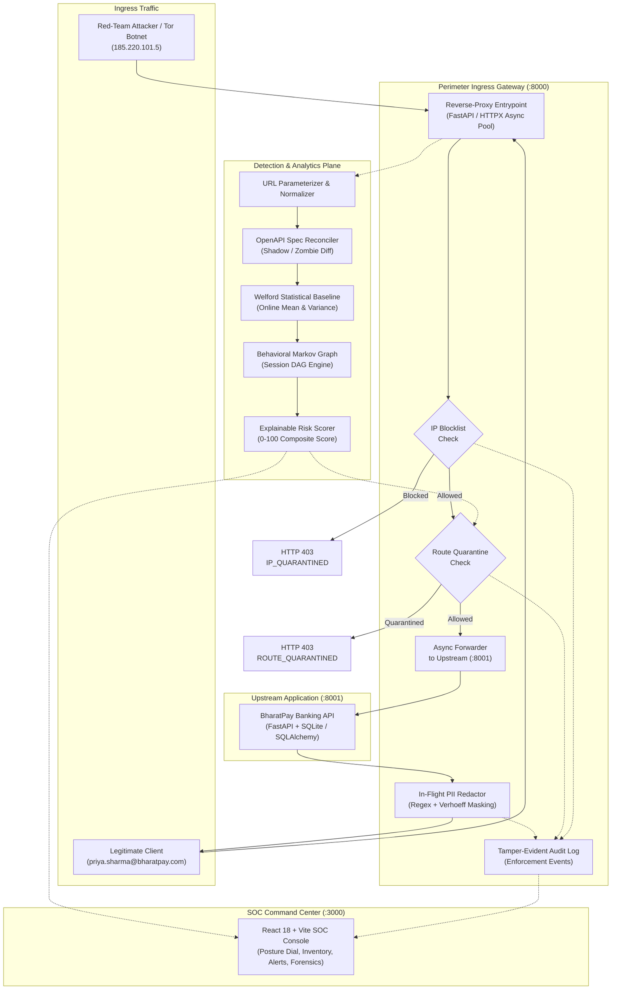
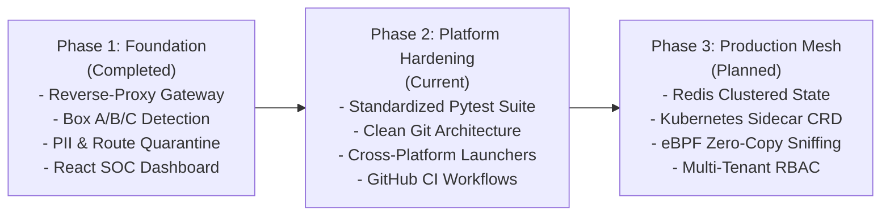

# Perimeter

**Autonomous API Security Posture Management (ASPM) & Inline Active Defense Layer**

[](https://github.com/vaidzss/perimeter/actions/workflows/ci.yml)
[](https://python.org)
[](https://fastapi.tiangolo.com)
[](https://react.dev)
[](https://vitejs.dev)
[](LICENSE)
[]()

---

## 1. Project Title & Positioning

**Perimeter** is an open-source **Application Security Posture Management (ASPM)** and **runtime active defense layer** engineered for API-driven architectures, distributed microservices, and sensitive financial platforms.

Modern microservice ecosystems suffer from constant release drift: rapid CI/CD velocity frequently introduces undocumented endpoints, forgotten debug backdoors, and broken authorization logic that bypass traditional perimeter defenses. Perimeter operates as an intelligent reverse-proxy security mesh positioned between incoming client traffic and upstream services. Without requiring code-level agent instrumentation, it discovers active routes, surfaces OpenAPI drift, detects runtime behavioral anomalies (such as Broken Object Level Authorization, scraping, and credential replay), and enforces inline active defense—including autonomous route quarantining, IP blacklisting, and in-flight sensitive data redaction.

---

## 2. Project Status

* **Current State:** **Active Development / Working Prototype & Benchmark Testbed**.
* **What Works Today:**
  * Inline HTTP reverse-proxy gateway with sub-millisecond route matching and parameter normalization.
  * Continuous API inventory generation with live OpenAPI 3.0 specification drift reconciliation.
  * Mathematical anomaly detection using Welford's algorithm for $O(1)$ running statistical baselines.
  * Heuristic detection for BOLA/IDOR enumeration, credential replay, and velocity-based data scraping.
  * UIDAI-compliant Verhoeff dihedral group $D_5$ algorithm for Aadhaar validation and regex-based Indian PII identification.
  * Stateful Markov Directed Behavioral Graph (DAG) session modeling for workflow violation detection.
  * In-flight sensitive PII redaction (`9999-XXXX-1001`, `ABCDE****F`) and instantaneous route/IP quarantining (`HTTP 403`).
  * Full React 18 + Vite SOC Command Center console and authentic vulnerable target neobank (*BharatPay*).
  * 130 passing unit, integration, and simulation tests.
* **Important Limitations:**
  * Currently operates as an HTTP reverse-proxy layer; raw packet capture via eBPF/AF_XDP is planned on the roadmap.
  * In-memory and SQLite-backed telemetry state is suitable for single-node deployment and testing; distributed clustered state (Redis/PostgreSQL) is in prototype status.
  * The software has not yet undergone an independent third-party security audit or regulatory compliance certification.

---

## 3. Overview: The Shadow Surface Dilemma

In cloud-native enterprises, APIs constitute over 80% of web traffic. However, traditional security tools struggle with contemporary API-specific threats:

1. **Traditional Web Application Firewalls (WAFs)** inspect request payloads for static injection signatures (SQLi, XSS). They lack semantic awareness of object relationships, stateful session workflows, or horizontal object enumeration.
2. **Static API Gateways** require explicit route registration. When a developer deploys an uncataloged internal route or forgets to decommission an older API version, the gateway forwards the traffic without governance.
3. **Out-of-Band Log Scanners** detect incidents hours or days after data exfiltration has already occurred, offering no runtime inline defense.

Perimeter resolves this blindspot by pairing continuous, real-time discovery with inline mathematical behavior scoring and deterministic active defense at the network boundary.

---

## 4. Problem Statement

| Vulnerability Class | Industry Challenge | Perimeter Approach |
| :--- | :--- | :--- |
| **Improper Inventory (OWASP API9:2023)** | Shadow backdoors and deprecated zombie routes remain accessible over public ingress without security oversight. | Compares live parameterized traffic continuously against governed OpenAPI specifications, categorizing endpoints into Documented, Shadow, Zombie, and Unused. |
| **BOLA / IDOR (OWASP API1:2023)** | Authenticated clients manipulate resource IDs to access records belonging to other tenants. | Profiles identity-to-object cardinality, session entropy, and sequential parameter sweeps using sliding-window metrics. |
| **Excessive Data Exposure (OWASP API3:2023)** | Backend endpoints return entire records containing unmasked government IDs, PANs, or account numbers. | Intercepts outgoing response streams on the wire and applies deterministic in-flight redaction before data leaves the boundary. |
| **Business Flow Bypass (OWASP API6:2023)** | Automated bots skip prerequisite verification or authentication steps to hit sensitive payment sinks directly. | Builds chronological Directed Behavioral Graphs per session, flagging transitions that bypass required workflow anchors. |

> **Distinction:** Perimeter focuses on runtime anomaly detection, drift identification, and policy-driven boundary containment. It complements, rather than replaces, formal identity providers (IdPs), static application security testing (SAST), and backend access control validation.

---

## 5. Key Capabilities

### Discovery & Specification Governance
* **Dynamic URL Parameterization:** Collapses high-cardinality dynamic paths (e.g., `/api/v2/accounts/1004/statement`) into canonical templates (`/api/v2/accounts/{id}/statement`).
* **OpenAPI Drift Reconciliation:** Evaluates live traffic against OpenAPI v3 specifications (`specs/openapi_partial.json` and upstream contracts).
* **Auto-Swagger Synthesis:** Automatically synthesizes OpenAPI 3.1 schema definitions for uncataloged shadow endpoints observed on the wire.

### Behavioral Analytics & Risk Scoring
* **Welford Algorithm Online Baselines:** Computes numerically stable running mean ($\mu$) and standard deviation ($\sigma$) in $O(1)$ time and memory without requiring expensive historical batch recomputation.
* **Verhoeff Mathematical Checksum:** Validates Aadhaar candidates using dihedral group $D_5$ permutations to prevent false-positive PII alarms on arbitrary 12-digit integers.
* **Explainable Composite Risk Scores:** Computes an explainable score ($0 - 100$) for every request, exposing additive reason vectors (`+35 Unauth`, `+25 PII`, `+20 Shadow`).
* **Context-Aware Session Graphing:** Constructs stateful Directed Behavioral Graphs (DAGs) per session to identify out-of-order execution and skip-step attacks.

### Active Defense & Inline Enforcement
* **Virtual Patching & Route Quarantine:** Drops requests to compromised or deprecated endpoints with `HTTP 403 Forbidden` (`ROUTE_QUARANTINED_BY_PERIMETER`).
* **IP Edge Quarantine:** Terminates connections from malicious proxies, Tor exit nodes, or aggressive scrapers (`IP_QUARANTINED_BY_PERIMETER`).
* **In-Flight Data Sanitizer:** Intercepts response payloads and redacts sensitive Indian identifiers (`9999-XXXX-1001`, `ABCDE****F`) in transit.

---

## 6. System Architecture

The diagram below illustrates the end-to-end request processing flow through the Perimeter platform:



---

## 7. Technical Stack

* **Backend & Security Gateway:** Python 3.12, FastAPI, Starlette, HTTPX, Uvicorn, Pydantic V2, PyJWT, WebSockets.
* **Data Persistence & Telemetry:** SQLite, SQLAlchemy 2.0, aiosqlite.
* **Mathematical & Algorithmic Modules:** NumPy, Welford's Algorithm ($O(1)$ online variance), Verhoeff Dihedral Group $D_5$ Algorithm, Shannon entropy estimators.
* **SOC Console Frontend:** React 18, Vite 5, TypeScript 5, Tailwind CSS, TanStack React Query, Recharts, Phosphor Icons, Lucide React.
* **Target Application Testbed:** BharatPay FinTech Neobank (FastAPI, SQLite, React Vite portal).
* **Quality Assurance & Testing:** Pytest 8, AnyIO, Faker, PyYAML.

---

## 8. Repository Structure

```text
perimeter/
├── .github/                       # GitHub Actions CI workflows and issue templates
│   ├── workflows/ci.yml           # Automated Python test & frontend build pipeline
│   ├── ISSUE_TEMPLATE/            # Bug report and feature request templates
│   └── pull_request_template.md   # Pull request checklist and guidelines
├── docs/                          # Detailed architecture and engineering documentation
│   ├── README.md                  # Documentation hub index
│   ├── architecture.md            # Component topology, request lifecycles, port mappings
│   ├── overview.md                # Problem statement, market landscape, value proposition
│   ├── feasibility.md             # Algorithmic complexity, latency profile, compliance
│   ├── simulation.md              # 8 red-team attack scenarios and active defense verification
│   ├── session_graphing.md        # Stateful behavioral DAG mechanics and anomaly checks
│   ├── identity_access.md         # RBAC scopes, role norms, operational policies
│   ├── api_reference.md           # Gateway control plane and telemetry API reference
│   └── images/                    # Architectural diagrams and telemetry visual assets
├── person1_api_discovery/         # Core Perimeter Security Gateway & Discovery Platform
│   ├── app/
│   │   ├── gateway.py             # Reverse-proxy ingress & inline active defense enforcement
│   │   ├── normalizer.py          # Dynamic URL normalizer & Indian PII regex classifier
│   │   ├── inventory_service.py   # Spec drift reconciliation & Auto-Swagger synthesizer
│   │   ├── person2_bridge.py      # Telemetry bridge connecting Gateway to Detection Engine
│   │   ├── deep_inspector.py      # Deep semantic inspection (SSRF, AST complexity, ReDoS)
│   │   ├── egress_guard.py        # SafeExternalAPIClient egress supply-chain guard
│   │   ├── main.py                # FastAPI gateway application entrypoint (Port 8000)
│   │   └── routers/               # Active defense, inventory, and SOC dashboard adapters
│   ├── specs/                     # Governed OpenAPI specifications for reconciliation
│   └── tests/                     # 47 unit and integration tests for gateway and discovery
├── traffic-detection-engine/      # Core AI & Mathematical Threat Detection Engine
│   ├── core/
│   │   ├── abuse/                 # Welford profiler, BOLA detector, replay & scraping detectors
│   │   ├── discovery/             # URL parameterizer, Verhoeff PII classifier, spec comparator
│   │   ├── graph/                 # Session graph engine (DAG construction & sequence checks)
│   │   └── scoring/               # Weighted composite risk scoring engine (0-100)
│   ├── pipeline.py                # Core detection engine telemetry pipeline coordinator
│   ├── server.py                  # Standalone telemetry ingestion server
│   ├── simulator.py               # Standalone Poisson process threat traffic generator
│   └── tests/                     # 20 mathematical, model, and simulation test cases
├── frontend/
│   ├── dashboard/                 # Perimeter SOC Command Center Web Console (Port 3000)
│   │   ├── src/pages/             # Overview, Inventory, Alerts, Investigations, Defense
│   │   ├── src/components/        # Recharts velocity charts, metric dials, forensic tables
│   │   └── package.json           # React 18, Vite, TypeScript dependencies
│   ├── bharatpay/                 # Vulnerable Neobank Target System (Port 8001 / 5173)
│   │   ├── backend/               # FastAPI + SQLite banking application
│   │   ├── frontend/              # Customer banking UI with Red-Team drawer
│   │   ├── seed/                  # Synthetic Indian banking seed generator
│   │   ├── spec/                  # Target OpenAPI 3.0 baseline specification
│   │   └── tests/                 # 56 banking, attack, and access control test cases
│   └── backend/                   # Legacy mock Express & FastAPI development servers
├── target_service/                # Lightweight standalone mock banking service & tests
├── tests/                         # Root integration and testbed verification test suite
├── demo_before_after.py           # Live before-and-after attack & active defense demonstration
├── verify_perimeter_defense.py    # 4-part automated defense assertion verification script
├── simulate_bharatpay_attack.py   # Red-team attack telemetry generation script
├── seed_demo_traffic.py           # Background benign traffic generator
├── run_all.ps1 / run_all.bat      # One-click multi-service orchestration scripts
├── stop_all.ps1                   # Clean shutdown utility script
├── pytest.ini                     # Unified test runner configuration
├── requirements.txt               # Unified Python dependency specifications
├── .env.example                   # Safe environment variable configuration template
├── .editorconfig                  # Consistent code formatting definitions
├── .gitattributes                 # Git text normalization and binary attributes
├── CONTRIBUTING.md                # Contributor guide and pull request standards
├── SECURITY.md                    # Vulnerability reporting and disclosure policy
├── CHANGELOG.md                   # Version history and release notes
└── LICENSE                        # Apache 2.0 open-source license
```

---

## 9. Prerequisites

* **Operating System:** Windows 10/11, macOS 12+, or modern Linux (Ubuntu 22.04+).
* **Python:** 3.12 or newer.
* **Node.js:** 18 LTS or newer (v20+ recommended).
* **npm:** 9+ or newer.
* **Git:** 2.30+ installed.

---

## 10. Installation & Local Setup

### Step 1: Clone Repository & Configure Python Environment

```bash
git clone https://github.com/vaidzss/perimeter.git
cd perimeter

# Create virtual environment
python -m venv .venv

# Activate virtual environment
# Windows (PowerShell):
.venv\Scripts\Activate.ps1
# Linux / macOS:
source .venv/bin/activate

# Install dependencies
python -m pip install --upgrade pip
pip install -r requirements.txt
```

### Step 2: Configure Environment Template

```bash
# Copy example configuration template
cp .env.example .env
```

### Step 3: Install Frontend Dependencies

```bash
# Install SOC Dashboard packages
cd frontend/dashboard
npm install
cd ../..

# Install BharatPay Neobank portal packages
cd frontend/bharatpay/frontend
npm install
cd ../../..
```

### Step 4: Seed Test Banking Database

```bash
python frontend/bharatpay/seed/seed.py
```

### Step 5: Launch Services

You can launch all services using the provided launcher scripts or run each service in separate terminal windows:

#### Automated Launcher (Windows PowerShell)
```powershell
.\run_all.ps1
```

#### Manual Multi-Terminal Launch

1. **Terminal 1 — BharatPay Neobank Backend (Port 8001):**
   ```bash
   cd frontend/bharatpay/backend
   python -m uvicorn app.main:app --host 0.0.0.0 --port 8001
   ```

2. **Terminal 2 — Perimeter Ingress Security Gateway (Port 8000):**
   ```bash
   # From repository root
   python -m uvicorn person1_api_discovery.app.main:app --host 0.0.0.0 --port 8000
   ```

3. **Terminal 3 — Perimeter SOC Console (Port 3000):**
   ```bash
   cd frontend/dashboard
   npm run dev
   ```

4. **Terminal 4 — BharatPay Customer Portal (Port 5173):**
   ```bash
   cd frontend/bharatpay/frontend
   npm run dev
   ```

---

## 11. Configuration Reference

All environment variables include safe local defaults defined in `.env.example`:

| Variable | Default Value | Description |
| :--- | :--- | :--- |
| `GATEWAY_HOST` | `0.0.0.0` | Gateway ingress host address. |
| `GATEWAY_PORT` | `8000` | Ingress security proxy listening port. |
| `UPSTREAM_TARGET` | `http://127.0.0.1:8001` | Upstream backend service destination. |
| `JWT_SECRET_KEY` | *(Safe demo string)* | Secret key for signing Perimeter internal tokens. |
| `JWT_SECRET` | *(Safe demo string)* | Secret key for validating upstream customer tokens. |
| `DATABASE_URL` | `sqlite:///./bharatpay.db` | Local SQLite database connection string. |
| `LOG_FILE_PATH` | `./logs/requests.jsonl` | Filepath for JSONL telemetry output stream. |
| `USE_MOCK` | `false` | When true, dashboard uses static offline mock fixtures. |

> **Security Note:** Never commit production private keys, database passwords, or operational secrets to version control. In production environments, inject credentials using dedicated secrets management solutions (e.g., HashiCorp Vault, AWS Secrets Manager).

---

## 12. Usage & Demonstrations

### 1. Verification of Active Defense Suite
Run the automated verification suite to validate all 4 core defense mechanisms against the live gateway:

```bash
python verify_perimeter_defense.py
```

**Expected Output:**
```text
======================================================================
  [SHIELD] VERIFYING PERIMETER ACTIVE DEFENSE: SAVING BHARATPAY [SHIELD]
======================================================================

[1/4] Testing In-Flight PII Redaction on Zombie KYC Dump...
      PASS: Raw Aadhaar 9999-XXXX-1001 and PAN ABCDE****F redacted in-flight!
[2/4] Deploying Route Quarantine Virtual Patch on Zombie & Shadow APIs...
      PASS: Zombie KYC Dump blocked with 403 -> Virtual patch: prevent bulk KYC exfiltration
      PASS: Shadow Backdoor blocked with 403 -> Virtual patch: block privilege escalation backdoor
[3/4] Testing IP Blacklisting against Tor Botnet Replay...
      PASS: Tor Exit Node 185.220.101.5 dropped at perimeter with 403 -> Tor exit node used in token replay attack
[4/4] Verifying Legitimate Customer Traffic (Priya Sharma) is 100% Uninterrupted...
      PASS: Priya Sharma profile loaded cleanly: Priya Sharma
      PASS: Merchant directory accessible (356 merchants)

======================================================================
  [SUCCESS] ALL 4 ACTIVE DEFENSE CONTROLS VERIFIED END-TO-END! [SUCCESS]
======================================================================
```

### 2. Live Before-and-After Attack Demonstration
Run the side-by-side comparative simulation demonstrating direct target exploitation versus perimeter neutralization:

```bash
python demo_before_after.py
```

### 3. Red-Team Attack Telemetry Generation
Simulate mixed benign and multi-vector malicious traffic across 8 OWASP attack vectors:

```bash
python simulate_bharatpay_attack.py
```

---

## 13. Testing & Validation

Perimeter includes a comprehensive automated test suite consisting of **130 tests** covering unit behavior, mathematical models, API endpoints, access control rules, and end-to-end simulations.

### Running the Full Test Suite

```bash
python -m pytest
```

**Verified Test Execution Summary:**
```text
============================= test session starts =============================
platform win32 -- Python 3.12.1, pytest-9.0.2, pluggy-1.6.0
configfile: pytest.ini
testpaths: tests, person1_api_discovery/tests, traffic-detection-engine/tests, frontend/bharatpay/backend/tests
collected 130 items

tests\test_target_service.py .......                                     [  5%]
person1_api_discovery\tests\test_checkpoint1.py .........                [ 12%]
person1_api_discovery\tests\test_checkpoint2.py ....                     [ 15%]
person1_api_discovery\tests\test_checkpoint3.py ...                      [ 17%]
person1_api_discovery\tests\test_checkpoint5.py ......                   [ 22%]
person1_api_discovery\tests\test_deep_inspector.py ................      [ 34%]
person1_api_discovery\tests\test_person1_pipeline.py .                   [ 35%]
person1_api_discovery\tests\test_phase2_blindspots.py ..                 [ 36%]
person1_api_discovery\tests\test_supply_chain_guard.py ......            [ 41%]
traffic-detection-engine\tests\test_box_a.py ....                        [ 44%]
traffic-detection-engine\tests\test_box_b.py ....                        [ 47%]
traffic-detection-engine\tests\test_box_c.py ...                         [ 50%]
traffic-detection-engine\tests\test_e2e_simulation.py .                  [ 50%]
traffic-detection-engine\tests\test_server.py .....                      [ 54%]
traffic-detection-engine\tests\test_session_graph.py ...                 [ 56%]
frontend\bharatpay\backend\tests\test_attacks.py ....                    [ 60%]
frontend\bharatpay\backend\tests\test_auth.py .......                    [ 65%]
frontend\bharatpay\backend\tests\test_banking.py .....                   [ 69%]
frontend\bharatpay\backend\tests\test_checkpoint11.py ...                [ 71%]
frontend\bharatpay\backend\tests\test_checkpoint12.py .....              [ 75%]
frontend\bharatpay\backend\tests\test_checkpoint13.py .....              [ 79%]
frontend\bharatpay\backend\tests\test_checkpoint14.py ......             [ 83%]
frontend\bharatpay\backend\tests\test_checkpoint15.py ...                [ 86%]
frontend\bharatpay\backend\tests\test_checkpoint16.py ...                [ 88%]
frontend\bharatpay\backend\tests\test_logging.py ....                    [ 91%]
frontend\bharatpay\backend\tests\test_seed_realism.py .....              [ 95%]
frontend\bharatpay\backend\tests\test_shadow_endpoints.py ....           [ 98%]
frontend\bharatpay\backend\tests\test_spec.py ..                         [100%]

============================= 130 passed in 6.35s =============================
```

### Reproducible Synthetic Benchmark Simulation
To reproduce the mathematical detection benchmark measuring detection accuracy and non-blocking latency:

```bash
python -m pytest traffic-detection-engine/tests/test_e2e_simulation.py -s
```

**Measured Benchmark Output (Controlled 140-Event Dataset):**
* **Total Events Processed:** 140
* **Average Detection Latency:** 0.193 ms
* **True Positives (TP):** 85 | **False Positives (FP):** 0
* **True Negatives (TN):** 50 | **False Negatives (FN):** 5
* **True Positive Rate (TPR):** 94.44%
* **False Positive Rate (FPR):** 0.0%

> **Methodology Note:** These metrics represent performance on a standardized synthetic simulation dataset designed to evaluate heuristic bounds. Real-world production accuracy depends on application traffic topology, parameter cardinality, and baseline training duration.

---

## 14. Security Considerations

* **Fail-Open vs. Fail-Secure:** In reverse-proxy mode, if the active defense gateway process is terminated, client traffic will be rejected at the transport layer unless high-availability load balancing (e.g., AWS ALB health checks, keepalived) is configured to route directly to upstream services.
* **Audit Trail Integrity:** Enforcement decisions (`ROUTE_QUARANTINED`, `IP_QUARANTINED`, `PII_MASKED`) are emitted synchronously to local structured logs. In production deployments, forward these events to an immutable remote SIEM (e.g., Elasticsearch, Splunk) over encrypted transport.
* **Audit Status:** **Perimeter has not yet undergone an independent third-party security audit.** It is currently provided for evaluation, security research, and engineering testbeds.

---

## 15. Project Roadmap



* **Completed Milestones:**
  * Real-time HTTP normalization and dynamic parameterization.
  * OpenAPI drift comparator and Auto-Swagger generation.
  * Welford algorithm $O(1)$ statistical anomaly profiling.
  * In-flight PII redaction and route/IP quarantining.
  * Unified 130-test automated test suite and clean build pipeline.
* **Current Work:**
  * Open-source repository architecture and public documentation polish.
  * Multi-platform CI/CD automation and containerization improvements.
* **Future Plans:**
  * Clustered multi-node state synchronization over Redis.
  * Transparent zero-copy wire sniffing via Linux eBPF/XDP.
  * Automated generation of WebAssembly (Wasm) filters for Envoy and Istio service meshes.

---

## 16. Contributing

Contributions are welcomed! Please review our [CONTRIBUTING.md](CONTRIBUTING.md) guide for instructions on local setup, branch naming, commit conventions, and pull request requirements.

---

## 17. License

The Perimeter codebase is licensed under the **Apache License 2.0** (see [LICENSE](LICENSE) and [frontend/LICENSE](frontend/LICENSE)).

> *Note: Formal repository-wide open source licensing is pending final administrative confirmation by project maintainers prior to official package distribution.*

---

## 18. Acknowledgements & References

* **OWASP API Security Top 10 (2023):** Primary threat taxonomy reference for API1 (BOLA), API2 (Broken Auth), API3 (Property Authorization), API4 (Unrestricted Resources), API6 (Business Flows), and API9 (Improper Inventory).
* **Welford, B. P. (1962):** *"Note on a method for calculating corrected sums of squares and products"*, Technometrics 4(3): 419–420.
* **Verhoeff, J. (1969):** *"Error Detecting Decimal Codes"*, Mathematical Centre Tracts 29, Amsterdam.
* **Digital Personal Data Protection (DPDP) Act 2023 & RBI Master Directions:** Regulatory guidance informing synthetic PII classification and in-flight redaction rules.

---

## 19. Team & Metadata

* **Repository:** [https://github.com/vaidzss/perimeter](https://github.com/vaidzss/perimeter)
* **Developers:** [@vaidzss](https://github.com/vaidzss) [@Vatts](https://github.com/VattsKumarMishra) [@Garvit](https://github.com/Garvitsisodia333)
* **Contact:** Through GitHub Issues or verified profile communication.
