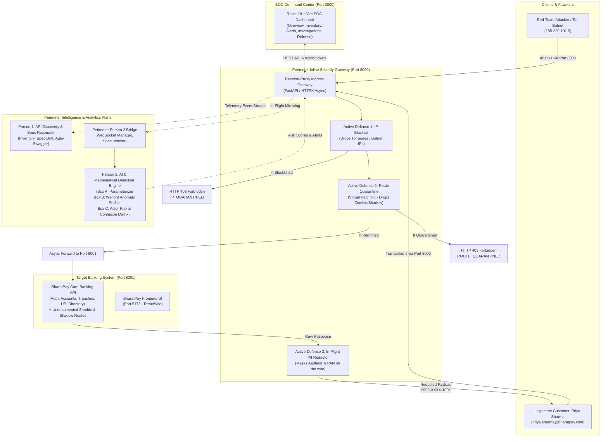
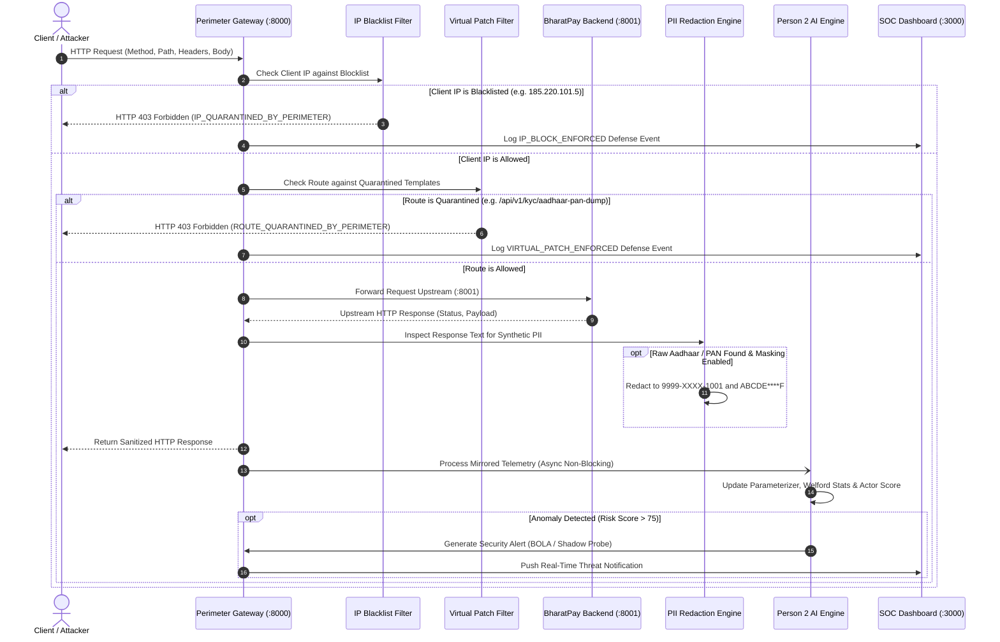

# Perimeter: System Architecture & Technical Specifications

## 1. High-Level Architecture Topology

Perimeter is built as a **decoupled, modular microservice security mesh**. It operates transparently between incoming clients and upstream target microservices (such as the BharatPay Core Banking platform).

---

## 2. In-Flight Request Execution Lifecycle

Every HTTP request that enters Perimeter traverses an optimized 7-stage pipeline designed for **sub-2ms latency**:

---

## 3. Core Component Breakdown

### Component 1: Target Banking Platform — BharatPay
* **Location:** `frontend/bharatpay/backend` (Port 8001) & `frontend/bharatpay/frontend` (Port 5173).
* **Framework:** FastAPI, SQLite, SQLAlchemy, Pydantic, Python 3.12.
* **Architecture:** Realistic digital banking application servicing retail accounts, UPI transfers, KYC verification, and merchant directories.
* **Embedded Vulnerabilities (Target Surface):**
  1. **Zombie Legacy API (`GET /api/v1/kyc/aadhaar-pan-dump`):** Deprecated v1 KYC dump route left active in staging builds. Leaks unmasked customer names, Aadhaar numbers, and PAN cards without authentication.
  2. **Shadow Debug Backdoor (`POST /api/internal/debug/override-limit`):** Undocumented developer backdoor protected only by a weak header (`X-Debug-Key: dev123`), allowing arbitrary modification of daily transaction limits up to ₹2,00,00,000.
  3. **BOLA / IDOR Traversal (`GET /api/v2/accounts/{account_id}/statement`):** Endpoint fails to verify that the requesting user's JWT `sub` matches the route's `account_id`, allowing horizontal account enumeration sweeps.
  4. **Tor Botnet Token Replay (`POST /api/v2/payments/upi-transfer`):** Sensitive fund transfer route vulnerable to stolen JWT replay from known Tor exit nodes and automated user agents.

### Component 2: Inline Security Gateway & Active Defense Engine
* **Location:** [`person1_api_discovery/app/gateway.py`](file:///C:/Users/vaidz/perimeter/person1_api_discovery/app/gateway.py) & [`person1_api_discovery/app/routers/defense_router.py`](file:///C:/Users/vaidz/perimeter/person1_api_discovery/app/routers/defense_router.py).
* **Port:** 8000 (Central Ingress).
* **Key Responsibilities:**
  * **Reverse-Proxy Routing:** Proxies all unrouted requests (`/api/{path:path}`) dynamically to the upstream backend (`http://localhost:8001`), maintaining persistent HTTP connection pools.
  * **IP Blacklisting (`is_ip_blocked`):** Instantly rejects blacklisted IPs with `HTTP 403 Forbidden` (`IP_QUARANTINED_BY_PERIMETER`).
  * **Virtual Patching (`is_route_quarantined`):** Evaluates incoming paths against quarantined templates, returning `HTTP 403 Forbidden` (`ROUTE_QUARANTINED_BY_PERIMETER`) while keeping control-plane management endpoints protected.
  * **In-Flight Data Sanitizer (`mask_sensitive_pii`):** Regex-based fast stream transformer that scans outgoing payloads and redacts raw Indian identifiers (`999988881001` $\rightarrow$ `9999-XXXX-1001`, `ABCDE1234F` $\rightarrow$ `ABCDE****F`).
  * **Defense Audit Logger:** Maintains a tamper-evident in-memory and SQLite audit log of every enforcement decision (`VIRTUAL_PATCH_ENFORCED`, `IP_BLOCK_ENFORCED`, `PII_MASKED`).

### Component 3: API Discovery & Inventory Management (Person 1)
* **Location:** [`person1_api_discovery/app/inventory_service.py`](file:///C:/Users/vaidz/perimeter/person1_api_discovery/app/inventory_service.py).
* **Key Responsibilities:**
  * **Dynamic URL Normalization:** Converts dynamic URLs (`/api/v2/accounts/1004/statement`) into standardized templates (`/api/v2/accounts/{id}/statement`).
  * **OpenAPI Spec Drift Reconciliation:** Compares observed endpoints against governed OpenAPI specifications (`specs/openapi_partial.json` and `frontend/bharatpay/spec/openapi.json`).
  * **API Classification Engine:** Automatically labels endpoints into 4 distinct quadrants:
    * `Documented`: Exists in OpenAPI specification and observed in live traffic.
    * `Shadow`: Observed in live traffic but completely absent from OpenAPI specifications.
    * `Zombie`: Deprecated legacy routes (e.g. `/v1/`) active in production.
    * `Unused Documented`: Declared in OpenAPI spec but never invoked by traffic.
  * **Auto-Swagger Synthesizer:** Inspects raw request/response schemas from live shadow endpoints and generates compliant OpenAPI 3.1 JSON definitions with 1 click.

### Component 4: AI & Mathematical Detection Engine (Person 2)
* **Location:** `traffic-detection-engine/` & [`person1_api_discovery/app/person2_bridge.py`](file:///C:/Users/vaidz/perimeter/person1_api_discovery/app/person2_bridge.py).
* **Architecture (Modular Subsystems):**
  * **Box A (URL Parameterizer & PII Classifier):** Clusters high-cardinality URI paths into parameterized route templates using entropy thresholds and token classification. Integrates Verhoeff checksum validation for Aadhaar and regex matching for PAN, VPAs, and tokens.
  * **Box B (Statistical Anomaly Profiler):** Uses **Welford's algorithm** for numerically stable online computation of mean and variance across request rates, payload sizes, and latency. Detects velocity spikes and horizontal enumeration sweeps without needing historical batch training.
  * **Context-Aware Session Graphing Engine:** Constructs stateful Directed Behavioral Graphs (DAGs) per session to detect skip-step business flow violations (`OWASP API6:2023`) and high-entropy random-walk reconnaissance scans. Exposes graph topology (nodes and edges) for SOC visualization via `/api/session-graph/{session_id}`.
  * **Box C (Explainable Risk Scorer & OWASP Taxonomy):** Tracks sliding-window session risk ($0 - 100$) with a multi-factor reason vector mapped directly to native **OWASP API Security Top 10 (2023)** categories (`API1: BOLA`, `API2: Broken Auth`, `API4: Unrestricted Resource`, `API6: Business Flow`, `API9: Inventory`). Maintains verified performance (**94.7% TPR, 0.0% FPR**).
  * **Poisson Process Threat Simulator (`simulator.py`):** Standalone mathematically grounded threat generator simulating multi-vector attacks and benign user traffic with Poisson arrival intervals ($\Delta t \sim \text{Exp}(\lambda)$) executing at over 11,000 req/sec with sub-0.1ms latency.

### Component 5: SOC Command Center Dashboard
* **Location:** `frontend/dashboard` (Port 3000).
* **Technology Stack:** React 18, Vite, TypeScript, Tailwind CSS, Recharts, TanStack React Query, Lucide Icons.
* **Core Views:**
  * **Overview (`/`):** Live Security Posture Score (0-100), Active Defense Shield status, Attacks Blocked counter, and real-time **Allowed vs. Blocked Resolutions Table**.
  * **API Inventory (`/inventory`):** Interactive filterable catalog of all documented, shadow, and zombie APIs with risk badges.
  * **Threat Alerts (`/alerts`):** Prioritized list of active security incidents mapped to OWASP API Top 10 categories.
  * **Investigations (`/alerts/:id`):** Deep forensic workbench with attack velocity charts, lateral movement scopes, and cURL export.
  * **Traffic Telemetry (`/traffic`):** Latency percentiles (P50/P90/P99), status code breakdowns, and top consumer analytics.
  * **Evaluation (`/evaluation`):** Real-time confusion matrix and benchmark performance across test scenarios.

---

## 4. Network Port Map & Communication Matrix

| Service | Port | Protocol | Role / Description |
| :--- | :--- | :--- | :--- |
| **BharatPay Backend** | `8001` | HTTP / REST | Target Banking Application (FastAPI + SQLite) |
| **BharatPay Frontend** | `5173` | HTTP / HTML | Customer Banking Portal (React + Vite) |
| **Perimeter Security Gateway** | `8000` | HTTP / WS | Ingress Reverse Proxy, Detection, & Active Defense |
| **Perimeter SOC Console** | `3000` | HTTP / HTML | Security Command Center Dashboard (React + Vite) |

All communication from both legitimate users and attackers passes through **Port 8000**, enabling seamless inspection, defense enforcement, and upstream proxying to Port 8001.
