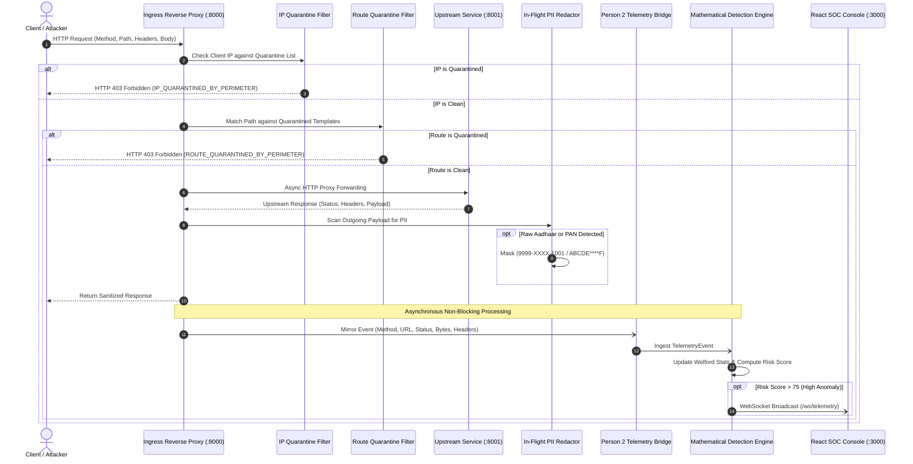

# Perimeter: In-Flight Telemetry & Active Defense Data Flow

This document details the internal request lifecycle, data transformations, and asynchronous event streams across the **Perimeter ASPM and Active Defense Gateway**.

---

## 1. High-Level Lifecycle Overview

When an incoming HTTP request reaches the Perimeter gateway on port `8000`, it traverses an optimized sequential pipeline before reaching the target application on port `8001`:

---

## 2. Ingress & Pre-Execution Checks

### Phase 1: IP Blacklist Evaluation
* **Location:** [`person1_api_discovery/app/gateway.py`](../../person1_api_discovery/app/gateway.py)
* **Complexity:** $O(1)$ set lookup against `QUARANTINED_IPS`.
* **Behavior:** If the client IP address (resolved via `request.client.host` or `X-Forwarded-For`) matches a quarantined entry, the connection is aborted immediately with `HTTP 403 Forbidden`. The request never touches the upstream backend.

### Phase 2: Route Virtual Patching
* **Location:** [`person1_api_discovery/app/gateway.py`](../../person1_api_discovery/app/gateway.py)
* **Mechanics:** Matches incoming request paths against regexes compiled from quarantined route templates (`QUARANTINED_ROUTES`).
* **Behavior:** If a route is marked quarantined, Perimeter intercepts the call and responds with `HTTP 403 Forbidden` (`ROUTE_QUARANTINED_BY_PERIMETER`), neutralizing unpatched backdoors or deprecated endpoints in sub-millisecond time.

---

## 3. Upstream Dispatch & In-Flight Response Redaction

### Phase 3: Async HTTP Forwarding
* **Connection Pool:** HTTPX `AsyncClient` maintains persistent connection pools to the upstream target (`http://127.0.0.1:8001`) with a default timeout of 10 seconds.
* **Header Preservation:** Preserves `Authorization`, `Content-Type`, and custom client headers while maintaining transparent reverse-proxy behavior.

### Phase 4: Wire PII Redaction
* **Location:** [`mask_sensitive_pii`](../../person1_api_discovery/app/gateway.py)
* **Patterns:**
  * **Aadhaar Numbers:** 12-digit candidate strings (`\b\d{4}[-\s]?\d{4}[-\s]?\d{4}\b`) masked to `9999-XXXX-1001`.
  * **PAN Cards:** 10-character alphanumeric sequences (`\b[A-Z]{5}\d{4}[A-Z]\b`) masked to `ABCDE****F`.
* **Zero-Downtime Guarantee:** Masking occurs in-stream without disrupting valid business payloads or modifying backend databases.

---

## 4. Telemetry Mirroring & Risk Scoring

Following response delivery, request telemetry is mirrored non-blockingly to the **Detection Engine**:

1. **Path Parameterization:** `URLParameterizer` normalizes raw paths (e.g., `/accounts/1004` $\to$ `/accounts/{id}`).
2. **OpenAPI Spec Comparison:** Compares observed route and method against loaded specifications, identifying specification drift (`DOCUMENTED`, `SHADOW`, `ZOMBIE`).
3. **Statistical Anomaly Evaluation:**
   * Updates per-endpoint request rate and response size running stats using Welford's algorithm.
   * Computes Z-scores ($Z = \frac{x - \mu}{\sigma}$) to detect rate spikes and data harvesting.
4. **Behavioral Heuristics:** Evaluates BOLA enumeration indicators, credential replay across disparate IPs, and session graph transition anomalies.
5. **Real-Time SOC Broadcast:** Emits alert payloads over WebSockets (`ws://localhost:8000/ws/telemetry`) to update the React console live.
