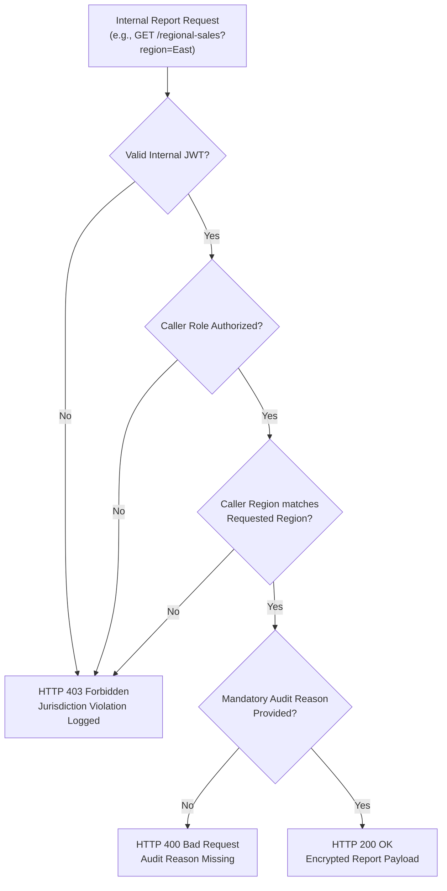
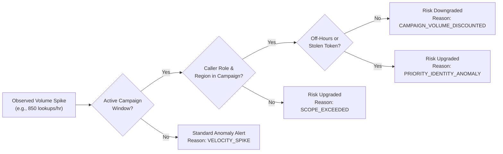

# Perimeter: Identity & Access Governance, Operational Baselines & Campaign Multipliers

## 1. Executive Summary & Purpose

Traditional API Security and Web Application Firewalls treat all API requests from an authenticated user identically. They have no concept of **corporate role hierarchy**, **regional jurisdiction**, or **planned business events** (e.g., nationwide festival sales). As a result, when an authorized regional sales manager or customer support agent queries accounts or experiences legitimate volume spikes, existing tools either:
1. **Trigger false positive alarms**, overwhelming SOC analysts with alert fatigue, or
2. **Fail to detect horizontal privilege abuse**, allowing an employee with a valid regional token to snoop on accounts in other jurisdictions or harvest sensitive data out of hours.

**Perimeter's Identity & Access Governance System** introduces a multi-layered identity intelligence mesh combining:
* **Strict Role-Based Operational Baselines (RBAC):** Bounding rate limits, scopes, and allowed endpoint sets across 6 corporate tiers.
* **Jurisdiction-Enforced Data Access:** Server-side validation ensuring regional tokens cannot inspect records outside their assigned geographical boundary.
* **Sanctioned Business Windows (Campaign Multipliers):** Dynamic volume discounting during approved sales events (e.g. Diwali Sale, Holi Festival) to suppress false positives while maintaining vigilance against token theft.
* **Transparent Reasoning Chains:** Every alert or risk adjustment explicitly documents *why* an action was flagged, upgraded, or discounted.

---

## 2. Organization & Role Hierarchy Model

Perimeter models 6 corporate roles across the enterprise with calibrated query limits, default scopes, and allowed endpoint catalogs:

| Role Name | Level | Default Scope | Normal Rate Limit | Campaign Rate Limit | Primary Allowed Endpoints |
| :--- | :---: | :--- | :---: | :---: | :--- |
| **Employee (Support)** | 1 | `support-tickets` | 150 req/day | 250 req/day | `/api/v2/internal/reports/account-lookup/{id}` (Reason required) |
| **Sales Manager** | 2 | `region` | 500 req/day | 2,500 req/day | `/api/v2/internal/reports/regional-sales`, `/account-lookup/{id}` |
| **Regional Head** | 3 | `multi-region` | 1,500 req/day | 7,500 req/day | `/regional-sales`, `/account-lookup/{id}`, `/bulk-export` |
| **VP Sales** | 4 | `org-wide` | 200 req/day | 5,000 req/day | `/regional-sales`, `/account-lookup/{id}`, `/org-wide-summary`, `/bulk-export` |
| **IT Admin** | 5 | `ops-only` | 500 req/day | 500 req/day | `/api/v2/internal/employees/*`, `/campaigns`, `/access-log` |
| **Compliance Officer** | 6 | `audit-read` | 1,000 req/day | 1,000 req/day | Read-only audit logs across all regions |

### Seeded Corporate Employees
The system is seeded with 12 realistic corporate identities across departments:
* `EMP-1001`: Rajesh Sharma (IT Admin - IT Ops, IT-Infra)
* `EMP-1002`: Sunita Rao (VP Sales - Sales, org-wide)
* `EMP-1003`: Vikram Malhotra (Regional Head - Sales, North)
* `EMP-1004`: Lakshmi Raman (Regional Head - Sales, South)
* `EMP-1005`: Abhijit Mukherjee (Regional Head - Sales, East)
* `EMP-1006`: Sanjay Patel (Sales Manager - Sales, West)
* `EMP-1007`: Preeti Deshmukh (Sales Manager - Sales, West)
* `EMP-1008`: Amit Verma (Sales Manager - Sales, North)
* `EMP-1009`: Suresh Menon (Sales Manager - Sales, South)
* `EMP-1010`: Neha Gupta (Employee Support - Customer Support, org-wide)
* `EMP-1011`: Rahul Choudhury (Employee Support - Customer Support, North)
* `EMP-1012`: Ananya Mukherjee (Employee Support - Customer Support, East - Fresh Hire)

---

## 3. Jurisdiction-Enforced Reporting & Reason Auditing

Every internal report query enforced by Perimeter requires cryptographic proof of role authority and region match:



### Server-Side Enforcement Rules:
1. **Regional Sales (`GET /api/v2/internal/reports/regional-sales`):**
   * If a Sales Manager in the `West` region attempts to query sales figures for the `East` region, the request is instantly rejected with `HTTP 403 Forbidden: Scope mismatch: Role Sales Manager with scope 'region:West' cannot access region 'East'`.
2. **Account Lookup (`GET /api/v2/internal/reports/account-lookup/{account_id}`):**
   * Support specialists and sales managers must provide an explicit, non-empty `reason` query parameter (e.g. `?reason=Customer+disputed+charge+ticket+491`). Failure to supply a reason returns `HTTP 400 Bad Request: Account lookup requires an explicit non-empty 'reason' parameter for audit trail`.
   * Enforces account region boundary: West employees cannot lookup North customer accounts.
3. **Bulk Export (`POST /api/v2/internal/reports/bulk-export`):**
   * Strict minimum role requirement: **Regional Head (Level 3)**. Sales Managers attempting bulk exports receive `HTTP 403 Forbidden` and trigger a **Privilege Escalation Alert**.
4. **Org-Wide Summary (`GET /api/v2/internal/reports/org-wide-summary`):**
   * Strict minimum role requirement: **VP Sales (Level 4)**.

---

## 4. Sanctioned Business Campaigns & Dynamic Multipliers

High-traffic business events (festival sales, cashback promotions) cause legitimate 5x to 10x traffic spikes that trigger false-positive alarms in unsophisticated anomaly detectors.

Perimeter introduces **Sanctioned Campaign Windows**:
```json
{
  "campaign_code": "CAMP-DIWALI-2026",
  "name": "Diwali Sale 2026",
  "start_date": "2026-10-13T00:00:00Z",
  "end_date": "2026-10-22T23:59:59Z",
  "affected_regions": ["West", "North", "South", "East", "org-wide"],
  "expected_roles": ["VP Sales", "Regional Head", "Sales Manager"],
  "expected_volume_multiplier": 10
}
```

### Pre-Registered Campaign Windows:
* **Diwali Sale 2026:** Multiplier $10\times$ across all regions for Sales roles.
* **Holi Cashback Dhamaka:** Multiplier $8\times$ across North, West, and East.
* **Fiscal Year-End Surge:** Multiplier $6\times$ org-wide for executive sales leadership.
* **Republic Day Merchant Fest:** Multiplier $5\times$ across South, West, and North.

---

## 5. Identity Context Resolver & Transparent Reasoning Chains

When an anomalous traffic spike occurs, the **Identity Context Resolver** (`identity_context_resolver.py`) inspects the ambient context before scoring risk:



### Risk Modifiers & Tokens:
1. `CAMPAIGN_VOLUME_DISCOUNTED`: When an authorized employee experiences a 6x spike during an active campaign affecting their region, risk score is reduced by **35 points**, and the alert is tagged with an informational reasoning chain explaining the discount.
2. `OFF_HOURS_PENALTY`: Activity between 11:00 PM and 5:00 AM IST receives a **+20 risk modifier** unless explicitly justified.
3. `TOKEN_THEFT_SUSPECTED`: If a high-volume request originates from a foreign IP/ASN or unrecognized User-Agent while claiming an executive employee identity, campaign discounts are bypassed, and risk is elevated to **CRITICAL (95/100)** with tag `PRIORITY_IDENTITY_ANOMALY`.
4. `FRESH_HIRE_GRACE`: Employees hired within the last 14 days receive bounded learning tolerance for onboarding orientation queries.

---

## 6. SOC Command Center UI Integration

The Perimeter SOC Dashboard provides dedicated controls for Identity & Access:
* **Interactive Navigation:** Dedicated `/identity` route available in the sidebar under **Identity & access**.
* **Live Onboard Member Modal:**
  * Allows IT Administrators (`EMP-1001`) to provision new corporate accounts directly.
  * Validates email uniqueness and assigns explicit roles and default scopes.
  * Rejects unauthorized onboarding attempts by non-IT Admins with real-time feedback.
* **Register Event / Campaign Modal:**
  * Allows executive leadership to declare upcoming marketing blitzes, festival surges, or promotional windows.
  * Automatically sets start/end timestamps, affected geographical territories, and expected volume multipliers.
* **Forensic Investigation Reasoning Inspector:**
  * When reviewing alerts in `/alerts/:id`, SOC analysts can view the full Identity Context breakdown: assigned role, department, home region, active campaign match, and step-by-step risk adjustments.
