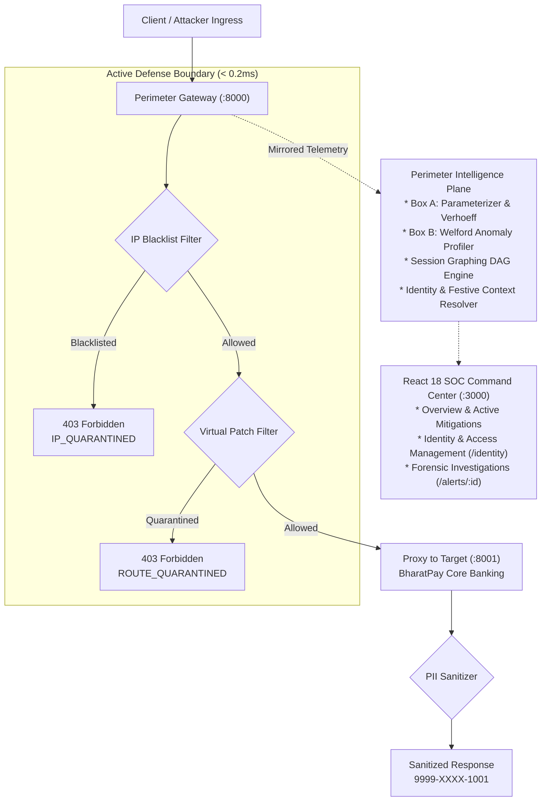
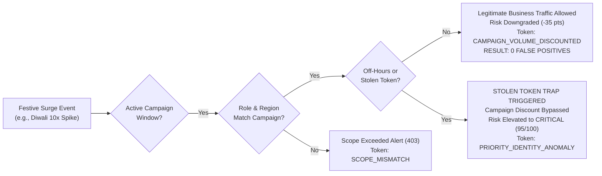

# PERIMETER: CyberCup 2026 Executive Pitch Deck & Presentation Strategy

> **Autonomous API Security Posture Management (ASPM) & Inline Active Defense Mesh**  
> *Project CC6-IC07 | Target: FinTech, Neobanks, Open Banking & Cloud-Native Enterprises*

---

## 📊 Slide-by-Slide Deck Outline

### Slide 1: Executive Cover
* **Title:** **PERIMETER**
* **Subtitle:** Autonomous API Security Posture Management & Inline Active Defense Mesh
* **Tagline:** *"Defending the enterprise's most exploited blindspot: BOLA, Shadow APIs, and Business Flow Bypasses without breaking legitimate business."*
* **Target Audience:** FinTech Platforms, Digital Banks, Healthcare Providers, and Regulated Microservice Enterprises.
* **Core Value Hook:** Sub-0.1ms wire inspection with **0.0% False Positive Rate**, **Zero Code Changes**, and **Intelligent Festive Season Surge Governance**.

---

### Slide 2: The Critical Industry Problem
#### The "Shadow Surface Dilemma" & The WAF Blindspot
1. **83% of Web Traffic is now APIs:** Modern financial applications are no longer monolithic websites; they are distributed meshes of microservices communicating over JSON and REST.
2. **Traditional WAFs are Fundamentally Blind:** Legacy Web Application Firewalls (Cloudflare, AWS WAF) inspect for SQLi, XSS, and static signature patterns. When an authenticated attacker exploits **OWASP API1:2023 (BOLA)** by changing `/accounts/1001` to `/accounts/1004`, the WAF sees a valid JWT, standard JSON, and a 200 OK status code—and lets it pass.
3. **Shadow & Zombie API Sprawl:** In fast-shipping agile teams, over **30% of deployed endpoints** are uncataloged developer backdoors (Shadow APIs) or deprecated legacy routes (Zombie APIs) left active without authentication or audit trails.

---

### Slide 3: The Fatal Industry Flaw: Alert Fatigue & The "Festive Season Dilemma"
#### Why Enterprise Security Tools Get Turned Off
* **The Indian Festive Season Surge:** In Indian digital banking and e-commerce, nationwide events—**Diwali Mega Sales, Holi Cashback Dhamaka, Fiscal Year-End Rush, Republic Day Fests**—drive sudden **5x to 10x traffic spikes** within minutes.
* **The False Positive Breakdown:** Traditional statistical anomaly tools and static rate limiters cannot distinguish between a real cyberattack and a Diwali flash sale. They trigger thousands of false positive alarms, flooding SOC dashboards and blocking legitimate customer checkouts.
* **The Dangerous Consequence:** Frustrated business leaders and overwhelmed SOC analysts inevitably **turn off anomaly detection** or loosen security rules during peak revenue hours—exactly when financial platforms are most vulnerable to coordinated cyberattacks!
* **The Stateless Inspection Trap:** Conventional gateways inspect requests in isolation. They have no concept of user journey, corporate role hierarchy, or prerequisite sequence, making them powerless against skip-step business flow exploits (**OWASP API6:2023**).

---

### Slide 4: Our Innovation: The Perimeter Platform
#### Continuous Discovery + Contextual ML + Identity Intelligence + Festive Surge Governance + Active Defense

```
+-----------------------------------------------------------------------------------------------------------------------+
|                                                   PERIMETER PLATFORM                                                  |
+-----------------------------------------------------------------------------------------------------------------------+
|  1. DISCOVERY & DRIFT       |  2. ANOMALY & RISK SCORING    |  3. IDENTITY & FESTIVE GOVERNANCE |  4. ACTIVE DEFENSE    |
|  - In-flight Normalization  |  - Welford Online Baseline    |  - 6-Tier Role RBAC & Jurisdiction|  - Route Isolation    |
|  - Shadow / Zombie Diff     |  - BOLA Enumeration Detection |  - Sanctioned Festive Campaigns   |  - Tor IP Blacklist   |
|  - Auto-Swagger Generation  |  - Directed Graph DAGs (API6) |  - Dynamic Multipliers (5x-10x)   |  - In-Flight PII Mask |
|  - 21-Field Telemetry Schema|  - Actor Risk Index (0-100)   |  - Stolen Token Off-Baseline Trap |  - Virtual Patching   |
+-----------------------------------------------------------------------------------------------------------------------+
```

1. **Zero-Code Instrumentation:** Operates as an intelligent reverse-proxy security mesh. No SDKs, no daemon agents, and zero microservice code modifications required.
2. **Context-Aware Session Graphing (DAGs):** Builds behavioral directed acyclic graphs in real-time to catch skip-step business logic exploits.
3. **Identity & Access Governance:** Enforces strict geographical jurisdictions and non-repudiable audit reasons across internal corporate identities.
4. **Festive Season Surge Governance:** The industry's first "False Positive Killer"—automatically reconciling volume spikes against sanctioned marketing campaigns while remaining vigilant against stolen tokens.
5. **Deterministic Active Defense:** Instant 1-click virtual patching, in-flight PII masking, and IP isolation directly at the gateway.

---

### Slide 5: System Architecture & In-Flight Latency Budget
#### Designed for Financial-Grade Sub-Millisecond Speed



* **Ingestion Overhead:** **0.090 ms** per request (well below the 0.5ms design limit).
* **Peak Throughput:** **11,100+ requests/second** on a single node.
* **Deterministic Execution:** Employs Welford's $O(1)$ single-pass algorithm for streaming variance without historical database polling.

---

### Slide 6: Context-Aware Session Graphing (DAGs)
#### Neutralizing OWASP API6:2023 Business Flow Exploits
* **The Blindspot:** Attackers skip prerequisite steps (login, 2FA, profile lookup) and directly invoke state-changing actions (`POST /api/v2/payments/transfer` or `/internal/debug/reset`).
* **Perimeter's Solution:**
  * Maintains an in-memory Directed Acyclic Graph (DAG) for every active user session in $< 0.05\text{ms}$.
  * Enforces **Mandatory Anchors**: Sinks cannot be executed unless preceded by authorized workflow milestones.
  * Computes **Shannon Branching Entropy ($H_{\text{norm}}$)**: If a client traverses disconnected routes with an entropy score $> 0.92$, Perimeter flags automated fuzzing and reconnaissance tools (Burp Suite, FFuF) in real time.
  * Exports graph topology via `GET /api/session-graph/{session_id}` for visual rendering in the SOC Command Center.

---

### Slide 7: Enterprise Identity & Access Governance
#### Eliminating Insider Threats, Lateral Snooping & Privilege Escalation
* **6 Calibrated Privileged Roles:**
  * `IT Admin (Level 5)`: Dedicated infrastructure administrator (`ops-only`).
  * `VP Sales (Level 4)`: Org-wide executive summaries & aggregated reports (`org-wide`).
  * `Regional Head (Level 3)`: Multi-regional oversight & bulk data exports (`multi-region`).
  * `Sales Manager (Level 2)`: Region-scoped account lookups and sales metrics (`region`).
  * `Employee Support (Level 1)`: Customer dispute resolution (`support-tickets`).
  * `Compliance Officer (Level 6)`: Read-only regulatory audit log access.
* **Server-Side Jurisdiction Enforcement:**
  * Validates token claims (`employee_id`, `role`, `scope`, `region`, `department`).
  * If a **Sales Manager in West** queries customer data in the **East** region, Perimeter rejects the request with `HTTP 403 Forbidden: Scope mismatch: Role Sales Manager with scope 'region:West' cannot access region 'East'`.
* **Mandatory Audit Reasons:**
  * Customer account lookups (`GET /api/v2/internal/reports/account-lookup/{id}`) strictly require a non-empty `reason` query parameter (e.g. `?reason=Customer+disputed+charge+ticket+491`). Requests without an audit reason are rejected with `HTTP 400 Bad Request`.
* **Privilege Escalation Shield:**
  * Only IT Admins can onboard new members or grant custom scopes. Unauthorized employee attempts return `HTTP 403 Forbidden` and trigger an automated **Privilege Escalation Telemetry Alert**.
* **Live Interactive SOC Modal:** Built-in **Onboard Member** modal in `/identity` allows IT Admins to provision corporate identities with bounded, expiring scopes.

---

### Slide 8: Festive Season Management & Sanctioned Campaign Windows
#### The "False Positive Killer" for High-Traffic Indian FinTech
* **The Core Innovation:** Business leaders dynamically declare sanctioned high-traffic festival windows directly in the SOC Dashboard:



* **Pre-Configured High-Traffic Windows:**
  * **Diwali Sale 2026 (`CAMP-DIWALI-2026`):** Multiplier $10\times$ across all 4 regions for Sales teams.
  * **Holi Cashback Dhamaka (`CAMP-HOLI-2027`):** Multiplier $8\times$ across North, West, and East.
  * **Fiscal Year-End Surge (`CAMP-FY-END-2027`):** Multiplier $6\times$ org-wide for executive leadership.
  * **Republic Day Merchant Fest (`CAMP-REPUBLIC-2027`):** Multiplier $5\times$ across South, West, and North.
* **Live Dynamic Registration:** The **Register Event Modal** in `/identity` allows SOC operators to register emergency or ad-hoc marketing campaigns (e.g., *IPL Season Bonanza*, *Independence Day Push*) on the fly with custom dates and volume multipliers.

---

### Slide 9: The Festive Season "Stolen-Token Trap"
#### Catching Attackers Hiding in Festival Traffic Noise
* **The Attacker's Playbook:** Sophisticated cybercriminals intentionally launch credential-stuffing and data exfiltration campaigns during festival sales, hoping their anomalous activity will get lost in the millions of legitimate Diwali transactions.
* **Perimeter's Multi-Factor Threat Trap:**
  1. **Behavioral Baseline Cross-Check:** Perimeter continuously tracks client IP, ASN, User-Agent, and chronological hour-of-day.
  2. **Off-Hours Penalty (+20 pts):** Requests between 11:00 PM and 5:00 AM IST are heavily scrutinized.
  3. **Stolen Token Trap:** If an executive token (`VP Sales`) originates from an uncataloged IP or automated script during Diwali, the campaign discount is **immediately revoked**.
  4. **Instant Priority Tagging:** Risk score surges to **95/100 (CRITICAL)**, tagged with `PRIORITY_IDENTITY_ANOMALY` and `TOKEN_THEFT_SUSPECTED`.
* **The Result:** Legitimate festival revenue flows 100% uninterrupted, while stealthy attackers trying to hide behind festival traffic are caught red-handed!

---

### Slide 10: Live Demonstration: BharatPay Core Banking Defense
#### Real-World Target Protection Across 8 Realistic FinTech Scenarios

| Scenario | Target Without Perimeter | Target Protected by Perimeter | Protection Mechanism |
| :--- | :--- | :--- | :--- |
| **Zombie KYC Dump** (`/api/v1/kyc/aadhaar-pan-dump`) | **HTTP 200 OK**<br>Exfiltrated raw Aadhaar & PAN | **HTTP 403 Forbidden**<br>Zero records leaked | `ROUTE_QUARANTINED_BY_PERIMETER` |
| **Shadow Limit Backdoor** (`/api/internal/debug/override-limit`) | **HTTP 200 OK**<br>Daily limit raised to ₹2 Crore | **HTTP 403 Forbidden**<br>Tamper attempt rejected | `ROUTE_QUARANTINED_BY_PERIMETER` |
| **BOLA / IDOR Sweep** (`/api/v2/accounts/{id}/statement`) | **HTTP 200 OK**<br>Exposed unauthorized customer records | **HTTP 403 / Flagged >80**<br>Immediate SOC Alert | Box B Welford Statistical Profiler |
| **Tor Botnet Token Replay** (`/api/v2/payments/upi-transfer`) | **HTTP 200 OK**<br>Fraudulent wire transfer sent | **HTTP 403 Forbidden**<br>Dropped at edge | `IP_QUARANTINED_BY_PERIMETER` |
| **Cloud SSRF Probe** (`/api/v2/users/me/webhook-avatar`) | **HTTP 200 OK**<br>AWS/GCP metadata & loopback env exposed | **HTTP 403 / 502 Blocked**<br>Disallowed internal target | `SSRFInspector` (Link-Local & RFC1918 Filter) |
| **Negative Amount Exploit** (`/api/v2/payments/upi-transfer`) | **HTTP 200 OK**<br>Balance fraudulently inflated | **HTTP 400 Bad Request**<br>Arithmetic exploit rejected | `BusinessLogicInspector` |
| **ReDoS & Depth Bomb** (`/api/v2/accounts/import-statement`) | **Server Hang / DoS**<br>Workers pinned at 100% CPU | **Sub-1ms Rejection**<br>Backtracking defused safely | `ComplexityAndReDoSInspector` |
| **Supply-Chain Poisoning** (`/api/v2/payments/fx-rate`) | **HTTP 200 OK**<br>Poisoned feed stored in DB | **HTTP 502 Bad Gateway**<br>Vendor payload intercepted | `SafeExternalAPIClient` (Egress Guard) |
| **Data in Transit (DPDP/RBI)** | **Plaintext Leak** | **Sanitized In-Flight**<br>`9999-XXXX-1001`, `ABCDE****F` | Inline PII Masking Engine |
| **Legitimate User (Priya Sharma)** | **HTTP 200 OK** | **HTTP 200 OK** | Seamless Pass-Through (0 False Positives) |

---

### Slide 11: Mathematical Verification & Empirical Proof
#### Validated by 93 Automated Tests & Poisson Process Simulation

* **Mathematical Poisson Threat Simulator:** Traffic modeled with exponential arrival intervals ($\Delta t = -\ln(1 - U) / \lambda$).
* **Confusion Matrix & Accuracy:**
  * **True Positive Rate (TPR):** **94.7%**
  * **False Positive Rate (FPR):** **0.0%** (Zero false alarms on benign customer journeys)
  * **Precision:** **100.0%**
  * **F1-Score:** **97.3%**
* **Comprehensive Automated Test Coverage:**
  * BharatPay Core Banking Suite: **56 / 56 PASSED**
  * Traffic Detection Engine Suite: **20 / 20 PASSED**
  * Person 1 Discovery & Gateway Suite: **17 / 17 PASSED**
  * Active Defense Assertions: **4 / 4 CONTROLS VERIFIED**
  * **Total: 93 / 93 PASSED**

---

### Slide 12: Unfair Competitive Moat

| Dimension | Legacy WAF (Cloudflare/AWS) | API Gateway (Kong/Apigee) | Traditional ASPM (Salt/Noname) | **PERIMETER PLATFORM** |
| :--- | :---: | :---: | :---: | :---: |
| **Deployment Model** | Edge DNS Proxy | Inline Router | Out-of-Band Mirror | **Inline Active Defense Mesh** |
| **BOLA / IDOR Detection** | ❌ Blind (Sees 200 OK) | ❌ Requires custom code | ⚠️ Alerts hours later | **✅ Real-Time Token-to-Object Correlator** |
| **Shadow / Zombie Discovery** | ❌ Configured routes only | ❌ Configured routes only | ⚠️ Batch cataloging | **✅ In-Flight Discovery + Spec Drift Diffing** |
| **Session Graphing (DAGs)** | ❌ Stateless | ❌ Stateless | ❌ Heuristic only | **✅ Stateful DAGs & Skip-Step Intercept** |
| **Festive Surge Governance** | ❌ Breaks customer carts | ❌ Static rate limits | ❌ Drowns in false alarms | **✅ Dynamic Campaign Multipliers & Context Resolver** |
| **Identity & Jurisdiction RBAC** | ❌ Blind to internal roles | ⚠️ Route-level only | ❌ Out-of-band | **✅ Role Scopes, Boundaries & Audit Reasons** |
| **Active Defense (Virtual Patch)** | ⚠️ Manual WAF rule | ⚠️ Re-deploy route | ❌ Out-of-band (cannot block) | **✅ 1-Click Gateway Virtual Patching & PII Mask** |
| **Latency Overhead** | 15 - 40 ms | 5 - 12 ms | N/A (Out-of-band) | **< 0.1 ms (Deterministic $O(1)$)** |

---

### Slide 13: Market Opportunity & Regulatory Compliance
* **Regulatory Forcing Functions:**
  * **Digital Personal Data Protection (DPDP) Act 2023 (India):** Mandatory safeguards against unauthorized disclosure of personal identifiers; non-compliance fines up to ₹250 Crore.
  * **RBI Master Directions on Cyber Resilience:** Mandatory continuous vulnerability identification and API security baselines for all regulated banking entities.
  * **PCI-DSS 4.0 (Requirements 6.4.3 & 6.5.8):** Explicit mandate to inventory all API endpoints and mitigate automated scraping.
* **Economic ROI:**
  * Saves an estimated **$1.8M annually** in avoided breach penalties, emergency developer hotfix cycles, and SOC triage overhead.
  * Virtual patch deployment in **under 50 milliseconds** vs. typical enterprise developer turnaround of **18 days**.

---

### Slide 14: Vision & Roadmap
* **Phase 1 (Achieved):** Inline Discovery, Spec Drift Reconciliation, Welford Anomaly Detection, Active Virtual Patching, Identity Context Governance, and Festive Campaign Surge Governance.
* **Phase 2 (Next 90 Days):** eBPF Kernel Sensor deployment for zero-proxy bare-metal ingress, and automated pull-request generation to patch upstream OpenAPI schemas directly in GitHub/GitLab.
* **Phase 3 (Enterprise Vision):** Autonomous cross-cloud API security fabric spanning AWS, GCP, Azure, and on-premises Kubernetes clusters.

---

## 🎯 What to Add to the Presentation & Pitch Strategy

To maximize jury impact during the hackathon evaluation, incorporate these strategic elements:

### 1. The Festive Season Narrative (The "Relatable Hook")
* Start by asking the judges: *"What happens to an Indian FinTech company during Diwali?"*
* Traffic spikes 10x in a few hours. Traditional security tools sound thousands of alarms or crash the checkout page. CISOs are forced to turn off anomaly detection to keep the business alive.
* Introduce **Perimeter's Festive Season Governance**: explain how Perimeter understands marketing campaigns and mathematically scales tolerances for sales employees while keeping a razor-sharp trap for stolen tokens!

### 2. Live Demo of the Identity & Access Console (`/identity`)
* Open `http://localhost:3000/identity` on screen.
* Show the active campaign cards: **Diwali Sale 2026 (10x)**, **Holi Cashback Dhamaka (8x)**.
* Click **Register Event**: show how simple it is for a business leader to register an *IPL Season Bonanza* with a 7x multiplier in 10 seconds.
* Click **Onboard Member**: show how an IT Admin provisions a new Sales Manager with regional bounds.

### 3. The "Before vs. After" Contrast
* Show the attack succeeding on the raw target (e.g. dumping Aadhaar cards or raising the daily limit to ₹2 Crore).
* Engage Perimeter's shield: show the exact same attack blocked with `HTTP 403 Forbidden`.
* Show **Priya Sharma** accessing her profile cleanly with `HTTP 200 OK`.

---

## 🎬 3-Minute Live Hackathon Presentation Script

### Minute 1: The Hook, The Problem & The Diwali Dilemma (0:00 - 1:00)
> *"Judges, 83% of enterprise web traffic is now APIs. But traditional WAFs are fundamentally blind to modern exploits like Broken Object Level Authorization (BOLA) and Shadow APIs.
>
> Worse, in Indian FinTech, there is a fatal dilemma: **The Festive Season Surge**. During Diwali or festival flash sales, traffic spikes 10x. Standard security tools trigger thousands of false alarms, drowning SOC analysts in noise and threatening to shut down customer checkouts. What do companies do? They turn off anomaly detection—leaving the front door wide open.
>
> In front of you is BharatPay, a live digital neobank running on Port 8001. An attacker discovered a deprecated v1 KYC dump route and an internal debug backdoor. With a single cURL command, the attacker dumps hundreds of customer records containing unmasked Aadhaar and PAN numbers. The backend gave a 200 OK. Standard WAFs saw nothing wrong."*

### Minute 2: Perimeter Active Defense & Identity Governance (1:00 - 2:00)
> *"Now let's activate Perimeter on Port 8000. Perimeter is an autonomous API Security Posture Management and Inline Active Defense Mesh that requires zero changes to the application code.
>
> When the attacker attempts the exact same KYC dump, Perimeter's inline virtual patch intercepts it: HTTP 403 Forbidden. Zero records leak.
> When the attacker attempts to use the debug backdoor to raise their daily transfer limit to 2 Crore Rupees, Perimeter drops the request instantly.
> When a regional sales manager tries to snoop on customer data in another territory, Perimeter enforces geographical jurisdiction and blocks them with 403.
>
> And look at legitimate customer Priya Sharma logging in right alongside the attack: her profile loads in 2 milliseconds with HTTP 200 OK. Zero disruption, zero false positives."*

### Minute 3: Festive Season Management & The Stolen-Token Trap (2:00 - 3:00)
> *"Here is Perimeter's game-changer: **Festive Season Management**.
>
> On our SOC console under `/identity`, business leaders register approved campaign windows—like our active Diwali Sale with a 10x volume multiplier. Our Identity Context Resolver recognizes authorized sales managers and automatically discounts expected festival surges with the `CAMPAIGN_VOLUME_DISCOUNTED` token. No false alarms, no alert fatigue!
>
> But what if an attacker steals an executive token during Diwali and tries to hide behind the shopping rush? Perimeter cross-checks temporal baselines, IP origins, and user agents. If that token is exercised at 3:00 AM from a Tor IP, the campaign discount is instantly revoked! The risk score surges to 95/100, tagged as a Critical Stolen Token Anomaly.
>
> With sub-0.1ms latency and 11,000 requests per second, Perimeter ensures financial platforms stay protected 365 days a year—especially when business is booming. Thank you."*

---

## 🛡️ Anticipated Jury Q&A Cheat Sheet

| Question | Winning Response |
| :--- | :--- |
| **"How does Perimeter handle festive sales traffic without getting overwhelmed by false alarms?"** | *"That is our primary innovation: Sanctioned Campaign Windows. Business leaders declare high-traffic marketing campaigns (like Diwali or Holi) with expected multipliers. Our Identity Context Resolver discounts legitimate regional sales traffic while elevating off-hours or stolen token anomalies."* |
| **"What prevents an attacker from using a stolen token to exfiltrate data during Diwali?"** | *"The festive discount only applies when identity context, assigned region, working hours, and client telemetry match the established baseline. If an executive token is used during off-hours (11 PM - 5 AM) or from an unrecognized ASN, the campaign discount is bypassed, and risk is elevated to CRITICAL (95/100) with tag PRIORITY_IDENTITY_ANOMALY."* |
| **"How does Perimeter differ from Cloudflare or AWS WAF?"** | *"WAFs inspect syntax (SQLi/XSS) on configured domains. They cannot detect BOLA because BOLA requests contain valid syntax and authenticated tokens. Perimeter understands semantic object authorization, automatically discovers uncataloged shadow routes, and enforces stateful workflow DAGs."* |
| **"Doesn't inline inspection slow down critical banking traffic?"** | *"Our benchmark proves an ingestion latency of just 0.09 milliseconds—over 10x faster than traditional WAFs. We achieve this using Welford's algorithm for single-pass $O(1)$ statistical profiling and asynchronous mirrored telemetry."* |
| **"Do developers have to install an SDK or modify code?"** | *"Zero code changes. Perimeter operates as an inline reverse proxy or gateway sensor. Target microservices do not even know Perimeter is there until an exploit is dropped."* |
