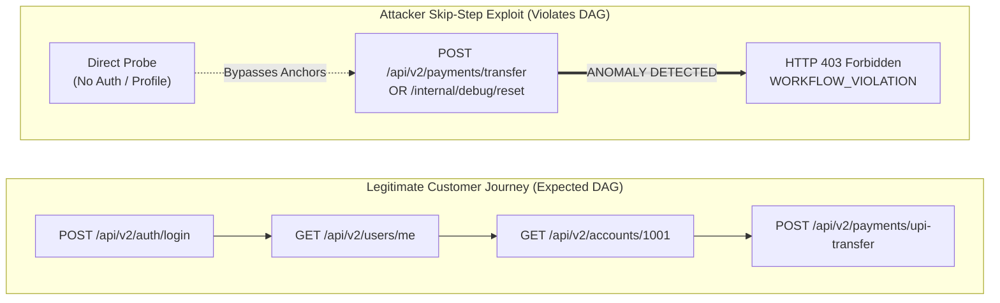

# Perimeter: Context-Aware Session Graphing & Behavioral DAG Engine

## 1. Executive Summary & Architecture

Traditional Web Application Firewalls (WAFs) and API gateways inspect each HTTP request as an **isolated, stateless event**. They check headers, payloads, and IP addresses in a vacuum, ignoring the chronological sequence of actions taken by a client.

This stateless inspection creates a massive blind spot for **OWASP API6:2023 (Unrestricted Access to Sensitive Business Flows)**:
* **Skip-Step Flow Bypass:** Attackers bypass required steps (e.g., identity verification, 2FA prompt, account lookup) and directly invoke sensitive state-changing endpoints (e.g., executing money transfers, password resets, or database dumps).
* **Random-Walk Reconnaissance & Fuzzing:** Attackers use automated tools (Burp Suite, FFuF, Nuclei) to rapidly sweep through unlinked endpoints in high-cardinality, non-human sequences.

**Perimeter's Session Graphing Engine** solves this by constructing **stateful Directed Acyclic Graphs (DAGs)** for every active user and client session in real-time.



---

## 2. Technical Mechanics of the Graph Engine

Located in [`traffic-detection-engine/core/graph/session_graph.py`](../traffic-detection-engine/core/graph/session_graph.py), the engine executes continuously in under **0.05ms** per request:

### 1. In-Memory Session DAG Maintenance
* **Session Key Identification:** Correlates requests using `session_id`, `jwt_sub`, or authenticated client IP.
* **Nodes & Edges Representation:**
  * **Nodes ($V$):** Every distinct parameterized route key (e.g., `GET:/api/v2/accounts/{id}/balance`) with invocation frequency counts.
  * **Directed Edges ($E$):** Sequential transitions between endpoints (`(prev_node, current_node)`), recording edge weights and transition frequency.
* **Sliding Sliding TTL:** Automatically prunes inactive sessions using a 300-second sliding expiration window to prevent memory leaks under massive scale.

---

## 3. Threat Detection Modules

### Anomaly Check 1: Sensitive Business Flow Bypass (Skip-Step)
* **Vulnerability Class:** OWASP API6:2023 (Unrestricted Access to Sensitive Business Flows).
* **Mechanism:**
  * Defines **Sensitive Sinks**: High-value business functions (`POST:/api/v2/payments/transfer`, `POST:/api/internal/debug/reset`, `GET:/api/v1/users/export-all`).
  * Defines **Valid Anchors**: Mandatory prerequisite milestones (`POST:/api/v2/auth/login`, `GET:/api/v2/users/{id}/profile`, `GET:/api/v2/accounts/{id}/balance`).
  * **Rule:** If an incoming request targets a Sensitive Sink without having previously recorded at least one Valid Anchor in the session's active graph, an immediate **CRITICAL Alert** is raised:
    ```json
    {
      "alert_type": "WORKFLOW_VIOLATION",
      "owasp_category": "API6:2023 - Unrestricted Access to Sensitive Business Flows",
      "severity": "CRITICAL",
      "confidence": 0.95,
      "reason": "Sensitive workflow 'POST:/api/v2/payments/transfer' invoked directly without preceding authentication or profile workflow"
    }
    ```

### Anomaly Check 2: High-Entropy Random-Walk Reconnaissance
* **Vulnerability Class:** Automated API Fuzzing & Lateral Reconnaissance.
* **Mechanism:**
  * Measures the **Shannon Branching Entropy** of the session's traversal graph:
    $$H = -\sum_{i=1}^{k} p_i \log_2(p_i)$$
    $$\text{Normalized Entropy } H_{\text{norm}} = \frac{H}{\log_2(k)}$$
    *(where $k$ is the count of unique endpoints visited, and $p_i$ is the empirical transition probability)*
  * **Detection Criteria:** If a session touches $\ge 6$ endpoints with $\ge 5$ distinct routes and exhibits an entropy $H_{\text{norm}} > 0.92$, the engine flags a **HIGH Severity Reconnaissance Scanner Alert**, detecting automated scrapers that hop across disconnected routes.

---

## 4. SOC Command Center Integration & Visualization

Perimeter exposes the session graph topology directly to security analysts via REST and WebSockets:

### Endpoint: `GET /api/session-graph/{session_id}`
Returns a Cytoscape / D3 graph dataset for visual rendering:

```json
{
  "session_id": "sess_usr_1001",
  "total_steps": 4,
  "current_node": "POST:/api/v2/payments/transfer",
  "nodes": [
    { "id": "POST:/api/v2/auth/login", "label": "/login", "method": "POST", "count": 1 },
    { "id": "GET:/api/v2/users/me", "label": "/me", "method": "GET", "count": 1 },
    { "id": "GET:/api/v2/accounts/{id}/balance", "label": "/balance", "method": "GET", "count": 1 },
    { "id": "POST:/api/v2/payments/transfer", "label": "/transfer", "method": "POST", "count": 1 }
  ],
  "edges": [
    { "source": "POST:/api/v2/auth/login", "target": "GET:/api/v2/users/me", "weight": 1 },
    { "source": "GET:/api/v2/users/me", "target": "GET:/api/v2/accounts/{id}/balance", "weight": 1 },
    { "source": "GET:/api/v2/accounts/{id}/balance", "target": "POST:/api/v2/payments/transfer", "weight": 1 }
  ]
}
```

### Forensic Value for Incident Responders:
1. **Lateral Movement Inspection:** Instantly view whether an attacker traversed through legitimate UI menus or jumped directly to undocumented endpoints.
2. **Blast Radius Analysis:** Trace all microservices visited by a compromised user session in the minutes preceding an unauthorized transaction.
3. **Automated Evidence Export:** Attach the directed graph JSON directly to incident tickets for developer remediation.
