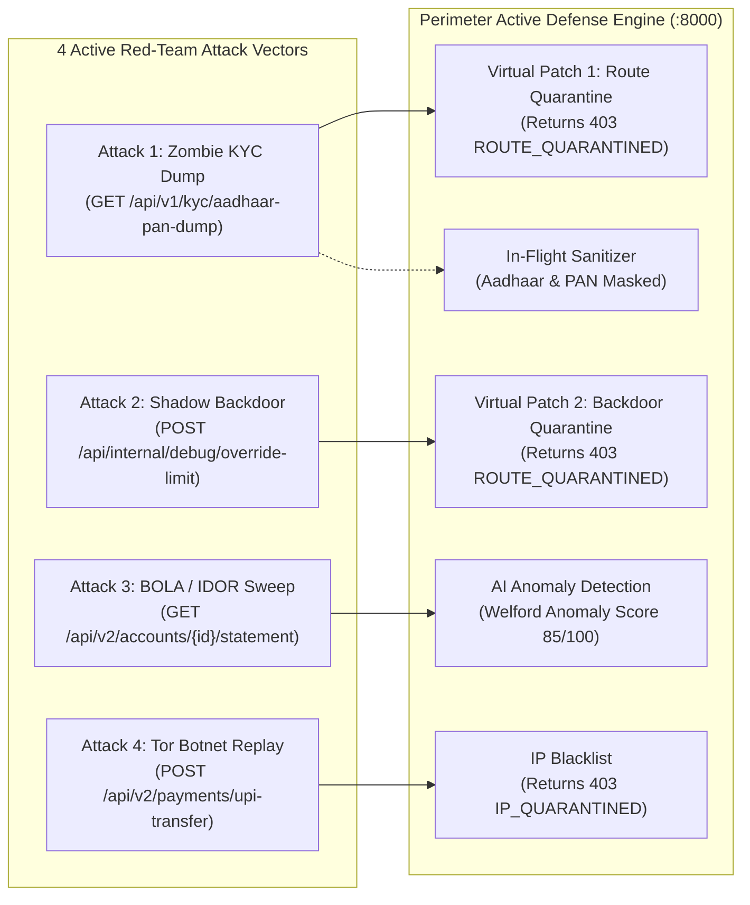

# Perimeter: Red-Team Cyberattack & Active Defense Simulation Guide

## 1. Simulation Overview & Context

To demonstrate how **Perimeter** defends a live enterprise banking infrastructure, we simulate a coordinated red-team cyberattack against **BharatPay Core Banking**.

BharatPay is an authentic FinTech application running on Port `8001`, guarded inline by the Perimeter Security Gateway on Port `8000`. The simulation demonstrates the two critical phases of modern ASPM:
1. **Observation Mode (Proof of Vulnerability):** Proves the vulnerabilities exist on unprotected target endpoints, triggering telemetry ingestion and real-time alerts on the SOC Dashboard.
2. **Active Defense Mode (Virtual Patching & Neutralization):** Enforces inline virtual patches, in-flight PII redaction, and IP bans, dropping the exact same attack vectors with `HTTP 403 Forbidden` while leaving legitimate customer traffic 100% uninterrupted.

---

## 2. The 4 Attack Vectors



### Attack 1: Zombie API Mass PII Harvest
* **Target Endpoint:** `GET /api/v1/kyc/aadhaar-pan-dump`
* **Vulnerability Class:** OWASP API9:2023 (Improper Inventory Management - Zombie API) & API3:2023 (Excessive Data Exposure).
* **Exploit Description:** An unauthenticated legacy v1 endpoint left active in staging builds. The attacker executes a single `GET` request and exfiltrates hundreds of customer KYC profiles containing unmasked Aadhaar numbers and PAN cards.
* **Perimeter Defense:**
  * **Route Quarantine:** Isolates the route at the gateway, returning `HTTP 403 Forbidden` (`ROUTE_QUARANTINED_BY_PERIMETER`).
  * **In-Flight Data Sanitizer:** If the route is accessed prior to quarantine, Perimeter's regex engine sanitizes identifiers on the wire (`9999-XXXX-1001`, `ABCDE****F`), preventing plaintext leakage.

### Attack 2: Undocumented Shadow Debug Backdoor
* **Target Endpoint:** `POST /api/internal/debug/override-limit`
* **Vulnerability Class:** OWASP API9:2023 (Shadow API) & API5:2023 (Broken Function Level Authorization).
* **Exploit Description:** An internal developer backdoor that bypasses normal banking workflows via a shared header (`X-Debug-Key: dev123`). The attacker escalates privileges and lifts their daily transfer ceiling from ₹50,000 to ₹2,00,00,000 (2 Crore Rupees).
* **Perimeter Defense:**
  * **Virtual Patching:** Quarantines the uncataloged shadow route with `HTTP 403 Forbidden` (`ROUTE_QUARANTINED_BY_PERIMETER`), neutralizing privilege escalation attempts without modifying backend code.

### Attack 3: BOLA / IDOR Horizontal Enumeration Sweep
* **Target Endpoint:** `GET /api/v2/accounts/{account_id}/statement`
* **Vulnerability Class:** OWASP API1:2023 (Broken Object Level Authorization - BOLA/IDOR).
* **Exploit Description:** The attacker authenticates as customer Priya Sharma (`account_id: 1001`), then script-probes accounts `1002` through `1015` in rapid succession, attempting to harvest unauthorized bank transaction statements.
* **Perimeter Defense:**
  * **Person 2 Box B (Statistical Profiling):** Detects excessive unique object ID traversal under a single user token within a sliding window.
  * **Risk Scoring:** Assigns an anomaly risk score ($> 80/100$) and triggers an immediate **Critical BOLA Alert** in the SOC Dashboard.

### Attack 4: Tor Botnet Credential Replay
* **Target Endpoint:** `POST /api/v2/payments/upi-transfer`
* **Vulnerability Class:** OWASP API2:2023 (Broken Authentication / Token Replay) & Automated Botnet Abuse.
* **Exploit Description:** The attacker replays a stolen bearer JWT token through an anonymous Tor Exit Node IP (`185.220.101.5`) using an automated script (`python-requests/2.31.0`) to initiate unauthorized wire transfers.
* **Perimeter Defense:**
  * **IP Quarantine:** Blacklists the malicious IP across the perimeter gateway.
  * **Edge Packet Drop:** All subsequent requests originating from `185.220.101.5` are immediately dropped with `HTTP 403 Forbidden` (`IP_QUARANTINED_BY_PERIMETER`).

---

## 3. How to Run the Live Simulations

Three standalone Python scripts are provided in the repository root for testing, demonstration, and automated verification:

### Script 1: Full Before-and-After Comparison Demo
Run [`demo_before_after.py`](file:///C:/Users/vaidz/perimeter/demo_before_after.py) to see the clear contrast between unprotected target behavior and Perimeter active protection:
```powershell
.\venv\Scripts\python.exe demo_before_after.py
```

**Output Walkthrough:**
* **Phase 1 (Target Exposed):** Shows Attack 1 (KYC leak) and Attack 2 (Limit override) succeeding against raw BharatPay (HTTP 200).
* **Phase 2 (Perimeter Engages):** Quarantines zombie/shadow routes, enables in-flight PII masking, and blacklists the Tor IP.
* **Phase 3 (Attacks Blocked):** Re-attempts the exact same attacks through Perimeter (Port 8000), proving they are **blocked with HTTP 403 Forbidden**.
* **Phase 4 (Legitimate User Traffic):** Demonstrates that normal customer Priya Sharma logs in and views account balances with **HTTP 200 OK** and **0 ms disruption**.

---

### Script 2: Active Defense Automated Verification
Run [`verify_perimeter_defense.py`](file:///C:/Users/vaidz/perimeter/verify_perimeter_defense.py) to run the 4-part automated defense assertion suite:
```powershell
.\venv\Scripts\python.exe verify_perimeter_defense.py
```

**Assertions Verified:**
1. `[1/4]` In-Flight PII Redaction (`****` and `XXXX` verified in transit).
2. `[2/4]` Route Quarantine Virtual Patching (Zombie & Shadow return HTTP 403).
3. `[3/4]` Tor Botnet IP Quarantine (185.220.101.5 dropped with HTTP 403).
4. `[4/4]` Legitimate Customer Experience (Priya Sharma loads cleanly with HTTP 200).

---

### Script 3: Observation Mode Telemetry Generator
Run [`simulate_bharatpay_attack.py`](file:///C:/Users/vaidz/perimeter/simulate_bharatpay_attack.py) to generate live attack telemetry to populate the SOC dashboard:
```powershell
.\venv\Scripts\python.exe simulate_bharatpay_attack.py
```

### Script 4: Mathematical Poisson Process Threat Simulator
Run [`traffic-detection-engine/simulator.py`](file:///C:/Users/vaidz/perimeter/traffic-detection-engine/simulator.py) to simulate multi-vector attacks and benign user traffic using a rigorous Poisson arrival process ($\Delta t \sim \text{Exp}(\lambda)$):
```powershell
# Direct in-memory engine pipeline benchmark (50-200 events, computes live TPR/FPR)
.\venv\Scripts\python.exe traffic-detection-engine/simulator.py --mode=direct --events=150 --rate=25

# Live telemetry ingestion stream to Perimeter Gateway
.\venv\Scripts\python.exe traffic-detection-engine/simulator.py --mode=http --target-url=http://localhost:8000/api/telemetry --events=100
```

---

## 4. Verification Matrix: Before vs. After Perimeter

| Vector | Target Without Perimeter | Target Protected by Perimeter | Protection Mechanism |
| :--- | :--- | :--- | :--- |
| **Zombie KYC Dump** | **HTTP 200 OK**<br>Exfiltrated raw Aadhaar & PAN | **HTTP 403 Forbidden**<br>Zero records leaked | `ROUTE_QUARANTINED_BY_PERIMETER` |
| **Shadow Limit Backdoor** | **HTTP 200 OK**<br>Daily limit raised to ₹2 Crore | **HTTP 403 Forbidden**<br>Tamper attempt rejected | `ROUTE_QUARANTINED_BY_PERIMETER` |
| **Tor Botnet Token Replay** | **HTTP 200 OK**<br>Fraudulent wire transfer sent | **HTTP 403 Forbidden**<br>Dropped at edge | `IP_QUARANTINED_BY_PERIMETER` |
| **Data in Transit** | **Plaintext Exposure** | **Sanitized Payload**<br>`9999-XXXX-1001`<br>`ABCDE****F` | Inline PII Masking Engine |
| **Legitimate User (Priya)** | **HTTP 200 OK** | **HTTP 200 OK** | Seamless Pass-Through (0 False Positives) |

---

## 5. Visual Verification in the Dashboard

Open the **SOC Command Center Dashboard** at [http://localhost:3000](http://localhost:3000):
1. **Perimeter Active Defense Card:** Verify the pulsing green **Shield Engaged** status.
2. **Attacks Blocked Counter:** Shows total dropped malicious requests (HTTP 403).
3. **Live Attack Resolutions Table:** Inspect the chronological stream of blocked vs. allowed API decisions.
4. **Threat Alerts Tab (`/alerts`):** Review individual security incidents categorized by OWASP API Top 10.
5. **Investigation Workbench (`/alerts/alt-01`):** Inspect timeline velocity charts and forensic cURL evidence.
