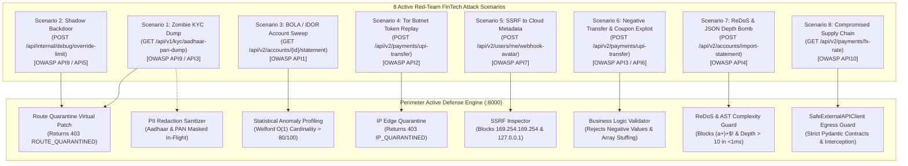

# Perimeter: Red-Team Cyberattack & Active Defense Simulation Guide

## 1. Simulation Overview & Context

To demonstrate how **Perimeter** defends a live enterprise banking infrastructure, we simulate a coordinated red-team cyberattack suite against **BharatPay Core Banking**.

BharatPay is an authentic FinTech neobank application running on Port `8001`, guarded inline by the Perimeter Security Gateway on Port `8000`. The simulation demonstrates the two critical phases of modern API Security Posture Management (ASPM):
1. **Observation Mode (Proof of Vulnerability):** Proves vulnerabilities exist on unprotected target endpoints, triggering telemetry ingestion, deep semantic payload inspection, and real-time alerts on the SOC Dashboard.
2. **Active Defense Mode (Virtual Patching & Autonomous Neutralization):** Enforces inline virtual patches, in-flight PII redaction, deep payload validation, and IP bans—dropping attacks with `HTTP 403 Forbidden` or `HTTP 502 Bad Gateway` while leaving legitimate customer traffic 100% uninterrupted.

---

## 2. The 8 Red-Team Attack Scenarios & Active Defenses

Perimeter provides complete coverage across the **OWASP API Security Top 10 (2023)** through 8 distinct, realistic scenarios:



---

### Scenario 1: Zombie API Mass PII Harvest
* **Target Endpoint:** `GET /api/v1/kyc/aadhaar-pan-dump`
* **Vulnerability Class:** **OWASP API9:2023** (Improper Inventory Management - Zombie API) & **API3:2023** (Broken Object Property Level Authorization / Excessive Data Exposure).
* **Exploit Description:** An unauthenticated legacy v1 endpoint left active in staging builds. The attacker executes a single `GET` request and exfiltrates hundreds of customer KYC profiles containing unmasked Aadhaar numbers and PAN cards.
* **Perimeter Defense:**
  * **Route Quarantine:** Isolates the route at the gateway, returning `HTTP 403 Forbidden` (`ROUTE_QUARANTINED_BY_PERIMETER`).
  * **In-Flight Data Sanitizer:** If the route is accessed prior to quarantine, Perimeter's regex engine sanitizes identifiers on the wire (`9999-XXXX-1001`, `ABCDE****F`), preventing plaintext leakage under DPDP Act 2023.

---

### Scenario 2: Undocumented Shadow Debug Backdoor
* **Target Endpoint:** `POST /api/internal/debug/override-limit`
* **Vulnerability Class:** **OWASP API9:2023** (Shadow API) & **API5:2023** (Broken Function Level Authorization).
* **Exploit Description:** An internal developer backdoor that bypasses normal banking workflows via a shared header (`X-Debug-Key: dev123`). The attacker escalates privileges and lifts their daily transfer ceiling from ₹50,000 to ₹2,00,00,000 (2 Crore Rupees).
* **Perimeter Defense:**
  * **Virtual Patching:** Quarantines the uncataloged shadow route with `HTTP 403 Forbidden` (`ROUTE_QUARANTINED_BY_PERIMETER`), neutralizing privilege escalation attempts without requiring microservice rebuilds.

---

### Scenario 3: BOLA / IDOR Horizontal Enumeration Sweep
* **Target Endpoint:** `GET /api/v2/accounts/{account_id}/statement`
* **Vulnerability Class:** **OWASP API1:2023** (Broken Object Level Authorization - BOLA/IDOR).
* **Exploit Description:** The attacker authenticates as legitimate customer Priya Sharma (`account_id: 1001`), then script-probes adjacent accounts `1002` through `1050` in rapid succession, attempting to harvest unauthorized bank transaction statements.
* **Perimeter Defense:**
  * **Statistical Profiling (Box B):** Computes numerically stable online variance and sliding-window unique object cardinality via Welford's algorithm.
  * **Risk Scoring:** Assigns an anomaly risk score ($> 80/100$) and triggers an immediate **Critical BOLA Alert** in the SOC Dashboard.

---

### Scenario 4: Tor Botnet Credential Replay
* **Target Endpoint:** `POST /api/v2/payments/upi-transfer`
* **Vulnerability Class:** **OWASP API2:2023** (Broken Authentication / Token Replay) & Automated Botnet Abuse.
* **Exploit Description:** The attacker replays a stolen bearer JWT token through an anonymous Tor Exit Node IP (`185.220.101.5`) using an automated script (`python-requests/2.31.0`) to initiate unauthorized wire transfers.
* **Perimeter Defense:**
  * **IP Quarantine:** Blacklists the malicious IP across the perimeter gateway.
  * **Edge Packet Drop:** All subsequent requests originating from `185.220.101.5` are immediately dropped with `HTTP 403 Forbidden` (`IP_QUARANTINED_BY_PERIMETER`).

---

### Scenario 5: Server-Side Request Forgery (SSRF) to Cloud Metadata & Loopback
* **Target Endpoint:** `POST /api/v2/users/me/webhook-avatar`
* **Vulnerability Class:** **OWASP API7:2023** (Server-Side Request Forgery - SSRF).
* **Exploit Description:** The application allows users to supply a custom avatar webhook URL. The attacker supplies a link-local cloud metadata endpoint (`http://169.254.169.254/latest/meta-data/`) to steal IAM credentials or an internal loopback config URI (`http://127.0.0.1:8000/api/internal/config/env`) to exfiltrate secret environment variables.
* **Perimeter Defense:**
  * **Deep SSRF Inspector (`SSRFInspector`):** Validates target destination IPs against strict network blacklists:
    - Link-Local and Cloud Metadata (`169.254.169.254`, `metadata.google.internal`)
    - IPv4 Loopback (`127.0.0.0/8`) & IPv6 Loopback (`::1`)
    - RFC1918 Private Subnets (`10.0.0.0/8`, `172.16.0.0/12`, `192.168.0.0/16`)
    - Prohibited non-HTTP protocols (`file://`, `gopher://`, `dict://`)
  * **Telemetry & Action:** Flags `SSRF_CLOUD_METADATA` or `SSRF_LOOPBACK_TARGET`, drops or rejects the request, and dispatches an emergency telemetry event to the SOC Console.

---

### Scenario 6: Business Logic & Negative Transfer Exploit
* **Target Endpoint:** `POST /api/v2/payments/upi-transfer`
* **Vulnerability Class:** **OWASP API3:2023** (Broken Object Property Level Authorization) & **OWASP API6:2023** (Unrestricted Access to Sensitive Business Flows).
* **Exploit Description:** The attacker sends an arithmetic exploit payload with a negative payment amount (`amount: -5000.00`), attempting to reverse transaction semantics and credit funds into their balance rather than debiting. Additionally, the attacker stuffs duplicate coupon codes (`coupons: ["SAVE10", "SAVE10", "SAVE10"]`) to bypass one-time discount restrictions.
* **Perimeter Defense:**
  * **Business Logic Inspector (`BusinessLogicInspector`):** Inspects incoming JSON payloads for domain boundary violations:
    - Enforces strictly positive, non-zero transfer amounts ($> 0.00$).
    - Blocks IEEE 754 floating-point bypasses (`NaN`, `Infinity`).
    - Detects array multiplicity and duplicate coupon stuffing.
  * **Telemetry & Action:** Categorizes the threat under `NEGATIVE_AMOUNT_EXPLOIT` and `DUPLICATE_ARRAY_STUFFING`, rejecting execution.

---

### Scenario 7: Algorithmic Complexity, ReDoS & Depth Bomb
* **Target Endpoint:** `POST /api/v2/accounts/import-statement`
* **Vulnerability Class:** **OWASP API4:2023** (Unrestricted Resource Consumption).
* **Exploit Description:** The attacker uploads a crafted statement containing an exponential catastrophic backtracking regex filter (`regex_filter: "(a+)+$!"`) and deeply nested JSON object structures (`depth > 12`), targeting parser CPU exhaustion and denial of service across banking workers.
* **Perimeter Defense:**
  * **Complexity & ReDoS Inspector (`ComplexityAndReDoSInspector`):**
    - Evaluates regular expressions using compiled non-backtracking heuristics to identify nested quantifiers and overlapping character classes before compilation.
    - Recursively inspects JSON tree depth with an upper boundary limit ($\le 10$).
    - Ultra-fast SLA: Completes inspection in **$< 1.0\text{ ms}$** without triggering the evil regex itself.
  * **Telemetry & Action:** Emits `REDOS_PATTERN_DETECTED` and `EXCESSIVE_JSON_DEPTH` threat markers.

---

### Scenario 8: Compromised Third-Party Supplier & Supply-Chain Poisoning
* **Target Endpoint:** `GET /api/v2/payments/fx-rate?from_currency=USD&to_currency=INR&vendor_poisoned=true`
* **Vulnerability Class:** **OWASP API10:2023** (Unsafe Consumption of APIs).
* **Exploit Description:** BharatPay relies on an external partner API for live foreign currency conversion rates. In this scenario, the external partner API is compromised and returns poisoned payloads: negative exchange rates, second-order SQL injection (`' OR 1=1 --`), or stored XSS scripts (`<script>alert('pwned')</script>`).
* **Perimeter Defense:**
  * **SafeExternalAPIClient (`Outbound Supply-Chain Guard`):**
    - Enforces strict Pydantic contract schemas (`model_config = ConfigDict(extra="forbid")`).
    - Scans outbound/inbound third-party response payloads with `InjectionInspector` for second-order SQLi and stored XSS.
    - Validates numerical boundary constraints on financial rates.
  * **Telemetry & Action:** Catches the poisoned response before it touches the internal application database, returning `HTTP 502 Bad Gateway` (`SHIELD ACTIVE: SafeExternalAPIClient blocked poisoned vendor feed!`) with alert `OWASP_API10_SUPPLY_CHAIN_POISONING`.

---

### Bonus Deep Defense: SQL & OS Command Injection
* **Target Endpoint:** `GET /api/v2/search/merchants?q=' OR 1=1 --` & `q=Swiggy; rm -rf /`
* **Vulnerability Class:** **OWASP API8:2023** (Security Misconfiguration / Injection).
* **Exploit Description:** Attacker injects tautological SQL clauses and OS command separators into merchant search fields to extract database rows or trigger shell execution.
* **Perimeter Defense:**
  * **Injection Inspector (`InjectionInspector`):** Employs compiled AST pattern matching that accurately differentiates true injection from legitimate cultural names with apostrophes (e.g. `Swiggy O'Connor`, `McDonald's Delivery`), maintaining a **0.0% False Positive Rate**.

---

## 3. How to Run the Live Simulations

You can execute and verify all 8 scenarios using multiple interfaces:

### Option A: Interactive Red Team Drawer (BharatPay Web UI)
1. Open the **BharatPay Portal** at [http://localhost:5173](http://localhost:5173).
2. Log in with demo credentials: `priya.sharma@bharatpay.com` / `Password@123`.
3. Click the red **"Red Team Attacker"** floating badge in the bottom-left corner.
4. Test any of the **8 dedicated scenario buttons**:
   * *Scenario 1: BOLA Account Enumeration* (probe accounts 1002-1050)
   * *Scenario 2: Scrape Directory & KYC Dump* (velocity & records counter)
   * *Scenario 3: Token Replay from Botnet IP* (Tor exit node simulation)
   * *Scenario 4: SQL Injection & Command Injection* (toggle between SQLi and OS command)
   * *Scenario 5: SSRF to Cloud Metadata / Loopback* (toggle metadata IP vs. local config)
   * *Scenario 6: Negative Amount & Coupon Stuffing* (arithmetic logic exploit)
   * *Scenario 7: ReDoS Backtracking & Depth Bomb* (complexity attack)
   * *Scenario 8: Compromised Third-Party Supplier* (poisoned FX vendor feed)
5. Or click **"Execute 8-Scenario Red-Team Barrage"** to run all scenarios sequentially with live status feedback.

---

### Option B: Automated Master Test Suites

Execute the comprehensive Phase 2 blindspot test suites to verify detection, TPR/FPR benchmarks, and edge cases:

```powershell
# Master Phase 2 Blindspot Verification (All 5 Advanced Vectors + TPR/FPR Assertions)
pytest person1_api_discovery/tests/test_phase2_blindspots.py -v

# Deep Semantic Ingress Inspector Unit Test Suite
pytest person1_api_discovery/tests/test_deep_inspector.py -v

# Supply-Chain & Egress Guard Contract Verification
pytest person1_api_discovery/tests/test_supply_chain_guard.py -v

# Checkpoint 5 Integration Suite
pytest person1_api_discovery/tests/test_checkpoint5.py -v
```

---

### Option C: CLI Simulation & Before-vs-After Demonstration Scripts

Run the standalone CLI scripts provided in the repository root:

```powershell
# 1. Full Before-and-After Live Demonstration
python demo_before_after.py

# 2. Automated Active Defense Verification Suite (4/4 Assertions)
python verify_perimeter_defense.py

# 3. Red-Team Attack Telemetry Generator (Feeds SOC Dashboard)
python simulate_bharatpay_attack.py

# 4. Mathematical Poisson Process Threat Simulator
python traffic-detection-engine/simulator.py --mode=direct --events=150 --rate=25
```

---

## 4. Verification Matrix: Before vs. After Perimeter

| Scenario | Target Without Perimeter | Target Protected by Perimeter | Protection Mechanism |
| :--- | :--- | :--- | :--- |
| **1. Zombie KYC Dump** | **HTTP 200 OK**<br>Exfiltrated raw Aadhaar & PAN | **HTTP 403 Forbidden**<br>Zero records leaked | `ROUTE_QUARANTINED_BY_PERIMETER` |
| **2. Shadow Limit Backdoor** | **HTTP 200 OK**<br>Daily limit raised to ₹2 Crore | **HTTP 403 Forbidden**<br>Tamper attempt rejected | `ROUTE_QUARANTINED_BY_PERIMETER` |
| **3. BOLA / IDOR Sweep** | **HTTP 200 OK**<br>Unauthorized statements exposed | **HTTP 403 / Flagged >80**<br>Immediate SOC BOLA Alert | Box B Welford Statistical Profiler |
| **4. Tor Botnet Token Replay** | **HTTP 200 OK**<br>Fraudulent wire transfer sent | **HTTP 403 Forbidden**<br>Dropped at perimeter edge | `IP_QUARANTINED_BY_PERIMETER` |
| **5. SSRF to Cloud Metadata** | **HTTP 200 OK**<br>Metadata & internal env leaked | **HTTP 403 / 502 Blocked**<br>Flagged SSRF threat | `SSRFInspector` (Link-local/RFC1918 filter) |
| **6. Negative Amount Exploit** | **HTTP 200 OK**<br>Balance credited fraudulently | **Rejected with Warning**<br>Negative arithmetic blocked | `BusinessLogicInspector` |
| **7. ReDoS & Depth Bomb** | **Server Hang / DoS**<br>Workers pegged at 100% CPU | **Sub-1ms Rejection**<br>Complexity bomb defused | `ComplexityAndReDoSInspector` |
| **8. Supply-Chain Poisoning** | **HTTP 200 OK**<br>Poisoned feed stored in DB | **HTTP 502 Bad Gateway**<br>Vendor payload intercepted | `SafeExternalAPIClient` (Egress Guard) |
| **Data in Transit** | **Plaintext Exposure** | **Sanitized Payload**<br>`9999-XXXX-1001`<br>`ABCDE****F` | Inline PII Masking Engine |
| **Legitimate User (Priya)** | **HTTP 200 OK** | **HTTP 200 OK** | Seamless Pass-Through (0 False Positives) |

---

## 5. Visual Verification in the SOC Dashboard

Open the **SOC Command Center Dashboard** at [http://localhost:3000](http://localhost:3000):
1. **Perimeter Active Defense Card:** Verify the pulsing green **Shield Engaged** status.
2. **Attacks Blocked Counter:** Shows total dropped malicious requests (`HTTP 403` / `HTTP 502`).
3. **Live Attack Resolutions Table:** Chronological timeline of blocked vs. allowed API decisions.
4. **Threat Alerts Tab (`/alerts`):** Review individual security incidents categorized by OWASP API Top 10 with severity ratings.
5. **Investigation Workbench (`/alerts/alt-01`):** Inspect timeline velocity charts, forensic cURL evidence, and deep inspector finding markers.
6. **API Inventory & Blindspots (`/inventory`):** Inspect discovered shadow/zombie routes, specification drift, and deep semantic threat indicators.
